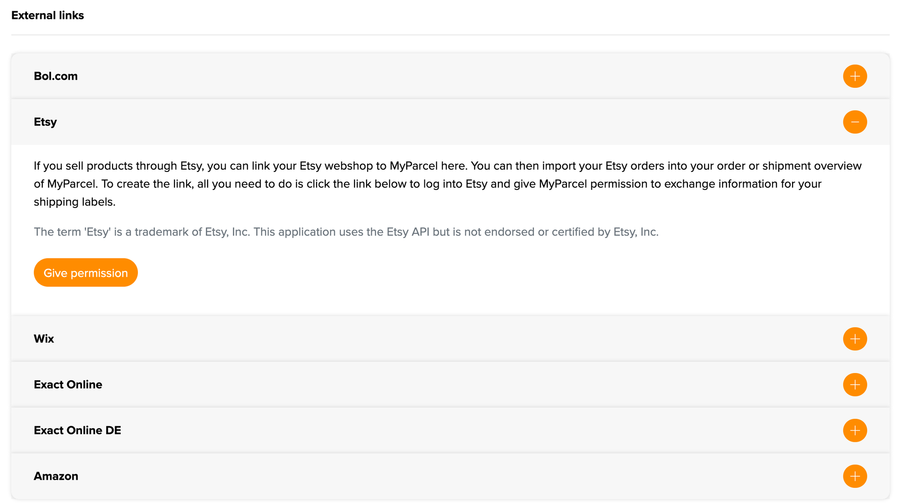
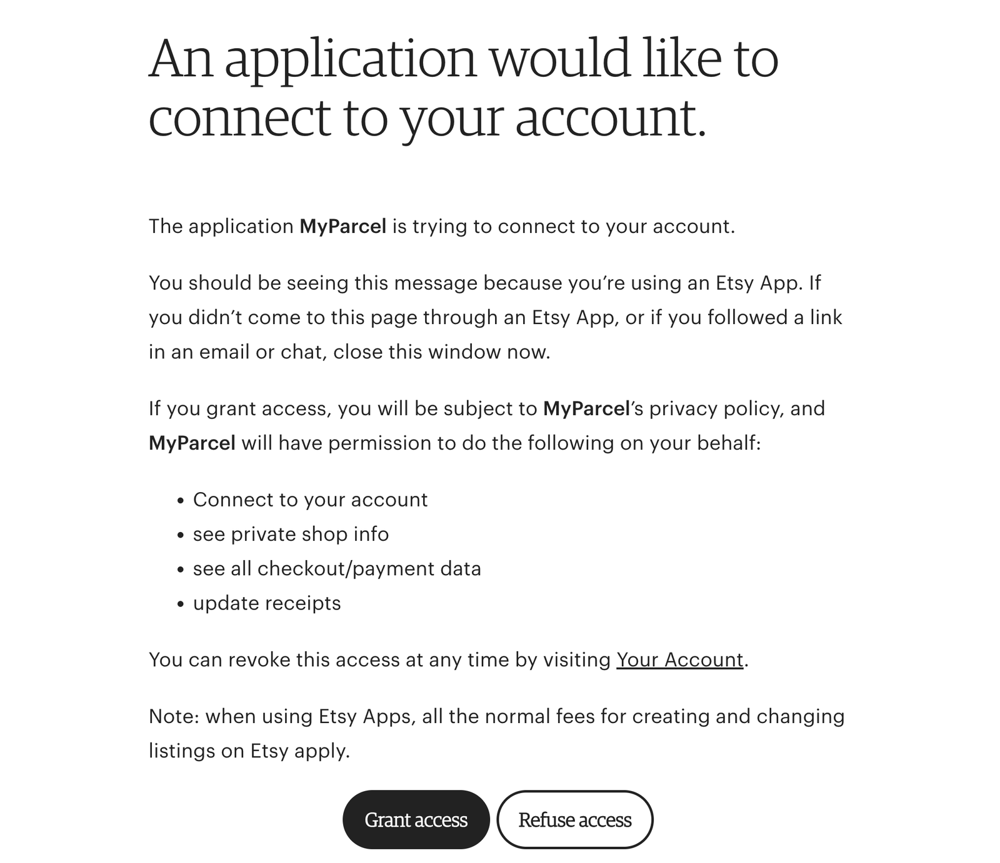
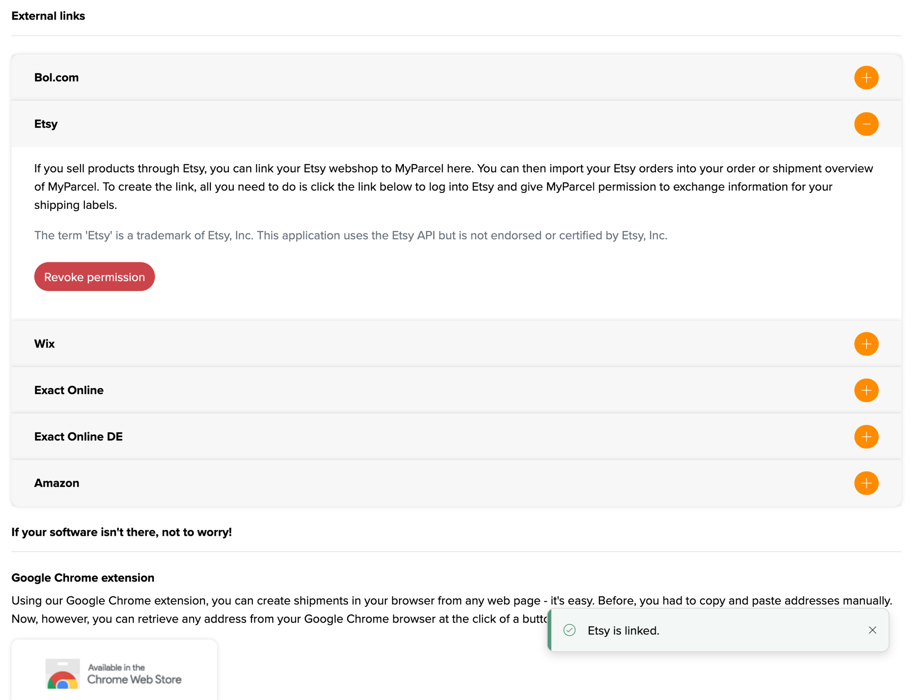
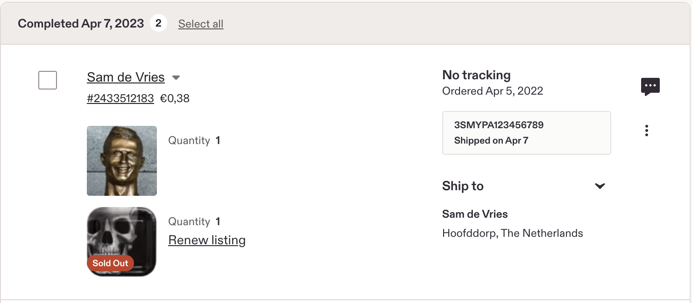
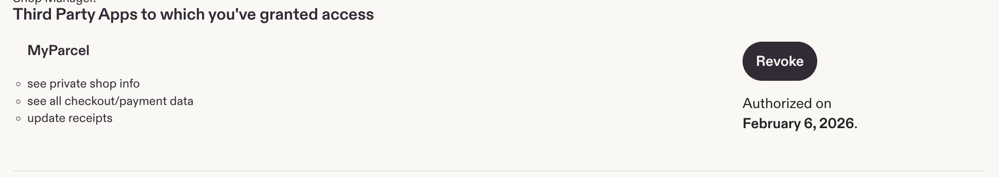

::: tip En bref
Etsy se connecte à MyParcel depuis la page **Intégration** de votre back-office MyParcel, sans rien installer. Vous donnez une seule fois l'autorisation à MyParcel dans votre compte Etsy. Ensuite, vous importez en un clic vos commandes Etsy ouvertes dans MyParcel, elles arrivent en **envois brouillons** et vous créez les étiquettes dans votre back-office MyParcel. MyParcel renvoie le code-barres vers Etsy et marque la commande comme expédiée. La connexion est gratuite.
:::

## Démarrage rapide, vos premières commandes Etsy en 5 minutes
De quoi relier Etsy à MyParcel dès aujourd'hui. Pour les détails, voir [Que cherchez-vous ?](#que-cherchez-vous) ci-dessous.

1. **Compte.** Vous n'avez pas encore de compte MyParcel ? Créez-en un sur [myparcel.nl/register](https://www.myparcel.nl/register).
2. **Ouvrez l'intégration.** Dans [backoffice.myparcel.nl](https://backoffice.myparcel.nl), allez dans *Paramètres de la boutique → Intégration*, descendez jusqu'à **External links** et ouvrez **Etsy**.
3. **Donnez l'autorisation.** Cliquez sur **Give permission**, connectez-vous à Etsy si on vous le demande et cliquez sur **Grant access**.
4. **Réglez le type de colis.** Choisissez le type de colis par défaut des commandes importées sous *Paramètres de la boutique → Envois*.
5. **Importez vos commandes.** Dans l'aperçu *Envois*, cliquez sur **Import external orders**, sélectionnez vos commandes Etsy et importez-les.

::: tip C'est terminé lorsque vous voyez ceci
- Le message **Etsy is linked.** et un bouton rouge **Revoke permission** sur le panneau Etsy
- **MyParcel** dans la liste *Apps You Use* de votre compte Etsy
- Vos commandes Etsy en envois brouillons dans l'aperçu *Envois*
:::

## Que cherchez-vous ?
| Que voulez-vous faire ? | Aller à |
| --- | --- |
| Comprendre comment fonctionne la connexion | [1 · Comment fonctionne la connexion](#1-comment-fonctionne-la-connexion) |
| Relier votre boutique Etsy | [2 · Relier Etsy](#2-relier-etsy) |
| Régler le type de colis des commandes importées | [3 · Type de colis par défaut](#3-type-de-colis-par-dfaut) |
| Importer des commandes et imprimer des étiquettes | [4 · Utilisation au quotidien](#4-utilisation-au-quotidien) |
| Déconnecter Etsy | [5 · Déconnexion](#5-dconnexion) |
| Quelque chose ne fonctionne pas | [6 · Un problème, diagnostic](#6-un-problme-diagnostic) |
| Réponse à une question fréquente | [7 · FAQ](#7-faq) |

## 1 · Comment fonctionne la connexion
Etsy est une place de marché, il n'y a donc ni plugin ni application à installer. Vous reliez une seule fois votre boutique Etsy depuis votre back-office MyParcel et donnez l'autorisation à MyParcel dans votre compte Etsy. MyParcel communique ensuite avec Etsy en votre nom.

Vous récupérez vous-même vos commandes Etsy ouvertes, qui arrivent dans MyParcel en envois brouillons. Vous créez les étiquettes dans votre back-office MyParcel, et MyParcel renvoie le code-barres vers Etsy et marque la commande comme expédiée.

La connexion utilise l'API d'Etsy, mais MyParcel n'est ni approuvé ni certifié par Etsy.

## 2 · Relier Etsy
1. Connectez-vous à [backoffice.myparcel.nl](https://backoffice.myparcel.nl) et allez dans **Paramètres de la boutique → Intégration**.
2. Descendez jusqu'à **External links** et ouvrez **Etsy** avec le bouton **+**.
3. Cliquez sur **Give permission**.

4. Vous êtes redirigé vers Etsy. Connectez-vous avec le compte Etsy de votre boutique si Etsy vous le demande.
5. Etsy affiche les autorisations demandées par MyParcel. Cliquez sur **Grant access**.

MyParcel demande ces autorisations :

| Autorisation | Pourquoi MyParcel en a besoin |
| --- | --- |
| **Connect to your account** | Pour relier votre boutique Etsy à votre boutique MyParcel. |
| **see private shop info** | Pour lire les informations de votre boutique. |
| **see all checkout/payment data** | Pour lire vos commandes et l'adresse de livraison. |
| **update receipts** | Pour renvoyer le code-barres et marquer la commande comme expédiée. |

De retour dans votre back-office MyParcel, vous voyez le message **Etsy is linked.** Le bouton du panneau Etsy est devenu un bouton rouge **Revoke permission**.

::: warning Partez toujours de MyParcel
N'ouvrez la page d'autorisation d'Etsy que via **Give permission** dans votre back-office MyParcel. Etsy vous conseille lui-même de fermer la page si vous y êtes arrivé par un lien dans un e-mail ou une discussion.
:::

## 3 · Type de colis par défaut
Les commandes Etsy importées arrivent en envoi standard. Le type de colis correspondant, par exemple un colis ou un colis boîte aux lettres, se règle sous **Paramètres de la boutique → Envois** dans votre back-office MyParcel. Faites-le avant votre premier import.

Vous pouvez modifier un envoi précis après l'import, voir [§4](#4-utilisation-au-quotidien).

## 4 · Utilisation au quotidien
1. Dans votre back-office MyParcel, ouvrez l'aperçu **Envois** et cliquez sur **Import external orders**.
2. Vos commandes Etsy ouvertes s'affichent. Sélectionnez celles à expédier et cliquez sur **Import**.
3. Les commandes arrivent en **envois brouillons**. Cliquez sur le crayon à côté d'un envoi pour le modifier, par exemple le type de colis ou les options de livraison.
4. Créez les étiquettes et remettez les colis au transporteur.

Dès que l'étiquette est imprimée, MyParcel envoie le code-barres à Etsy et la commande passe en expédiée. Dans votre aperçu des commandes Etsy, vous voyez le code-barres sur la commande, avec la date d'expédition.

::: warning Envois hors UE
Vous pouvez importer des commandes avec une adresse hors UE, mais le formulaire de douane n'est pas entièrement rempli. Vérifiez et complétez les données douanières sur l'envoi brouillon avant de créer l'étiquette.
:::

Vous ne payez un envoi qu'une fois qu'il est réellement remis au transporteur.

## 5 · Déconnexion
Vous pouvez mettre fin à la connexion à deux endroits :

- **Dans MyParcel.** Allez dans *Paramètres de la boutique → Intégration → External links → Etsy* et cliquez sur **Revoke permission**.
- **Dans Etsy.** Allez dans les paramètres de votre compte, ouvrez **Apps** et cliquez sur **Revoke** à côté de MyParcel. Sous *Third Party Apps to which you've granted access*, vous voyez aussi quand vous avez donné l'autorisation.

Vous voulez vous reconnecter plus tard ? Cliquez sur **Give permission** dans votre back-office MyParcel et accordez à nouveau l'accès.

## 6 · Un problème, diagnostic
Parcourez ce tableau de haut en bas, la plupart des problèmes se règlent en quelques minutes.

| Symptôme | Que vérifier |
| --- | --- |
| **Le panneau Etsy affiche encore Give permission** | La connexion n'a pas abouti. Cliquez à nouveau sur **Give permission** puis sur **Grant access** dans Etsy ([§2](#2-relier-etsy)). |
| **Etsy affiche le mauvais compte** | Vous êtes connecté à Etsy avec un autre compte. Déconnectez-vous d'Etsy, connectez-vous avec le compte de votre boutique et recommencez depuis MyParcel. |
| **Aucune commande n'apparaît à l'import** | Seules les commandes ouvertes sont importées. Vérifiez que la commande n'est pas déjà marquée comme expédiée dans Etsy, et que MyParcel figure toujours sous *Apps* dans votre compte Etsy ([§5](#5-dconnexion)). |
| **Les commandes importées ont le mauvais type de colis** | Vérifiez la valeur par défaut sous *Paramètres de la boutique → Envois* ([§3](#3-type-de-colis-par-dfaut)), ou modifiez l'envoi brouillon avant de créer l'étiquette. |
| **Le code-barres n'apparaît pas dans Etsy** | Le code-barres est envoyé dès que l'étiquette est imprimée. Aviez-vous déjà marqué la commande comme expédiée dans Etsy avant ? |
| **Erreur de douane sur un envoi hors UE** | Complétez les données douanières sur l'envoi brouillon ([§4](#4-utilisation-au-quotidien)). |

## 7 · FAQ

### Dois-je installer quelque chose ?
Non. Etsy se connecte depuis votre back-office MyParcel, il n'y a ni plugin ni application.

### Est-ce payant ?
Relier Etsy est gratuit. Vous payez vos envois comme d'habitude.

### Les commandes sont-elles importées automatiquement ?
Non. Vous récupérez vous-même vos commandes Etsy ouvertes avec **Import external orders** dans l'aperçu *Envois*.

### Renvoyez-vous le code-barres vers Etsy ?
Oui. Dès que l'étiquette est imprimée, MyParcel envoie le code-barres à Etsy et marque la commande comme expédiée.

### Comment mettre fin à la connexion ?
Cliquez sur **Revoke permission** dans votre back-office MyParcel, ou sur **Revoke** sous *Apps* dans votre compte Etsy ([§5](#5-dconnexion)).

## Ressources & support
- [backoffice.myparcel.nl ↗](https://backoffice.myparcel.nl), intégration, envois, compte et facturation.
- [Expédier vos commandes Etsy avec MyParcel ↗](https://www.myparcel.nl/koppelingen/etsy-verzenden/).
- [Contacter le support MyParcel](../../contact.md), **023 - 30 30 315** · [info@myparcel.nl](mailto:info@myparcel.nl).

Ce manuel décrit la connexion Etsy dans le back-office MyParcel telle qu'elle fonctionne en octobre 2026. Les écrans côté Etsy peuvent légèrement varier selon la langue du compte.
