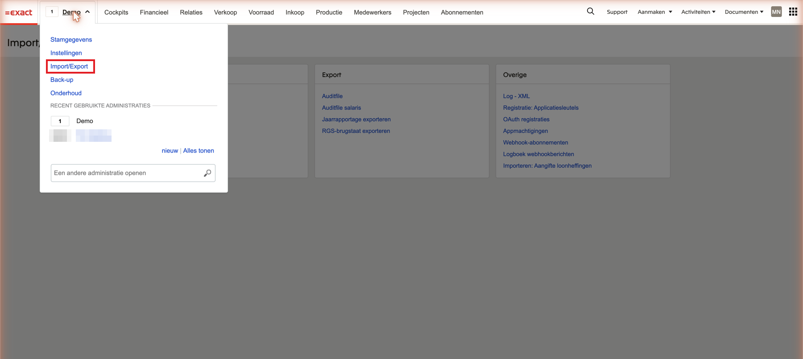
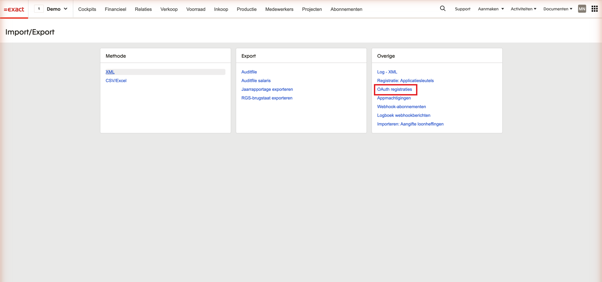
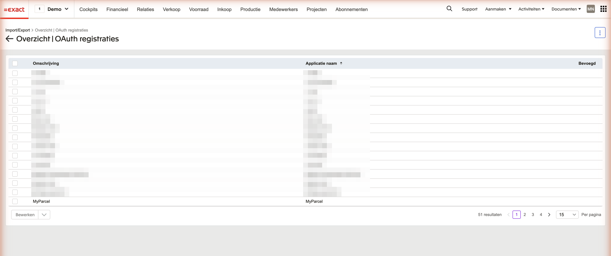
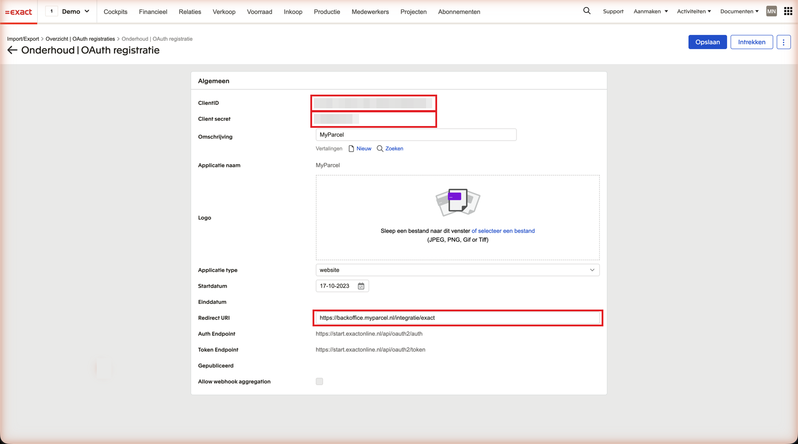

::: tip En bref
Exact Online se connecte à MyParcel depuis la page **Intégration** de votre back-office MyParcel, sans rien installer. Vous enregistrez une seule fois une app MyParcel dans Exact Online et vous copiez son **Client ID** et son **Client secret** dans MyParcel. Ensuite, vous importez en un clic vos livraisons de marchandises ouvertes depuis Exact Online. Elles arrivent en **envois brouillons** et vous créez les étiquettes dans votre back-office MyParcel. MyParcel écrit le code-barres dans la livraison de marchandises dans Exact Online. Pour cette connexion, vous avez besoin du module Exact Online *Handel*.
:::

## Démarrage rapide, vos premières livraisons en 10 minutes
De quoi relier Exact Online à MyParcel dès aujourd'hui. Pour les détails, voir [Que cherchez-vous ?](#que-cherchez-vous) ci-dessous.

1. **Compte.** Vous n'avez pas encore de compte MyParcel ? Créez-en un sur [myparcel.nl/register](https://www.myparcel.nl/register).
2. **Enregistrez l'app.** Dans Exact Online, cliquez sur le nom de votre administration → **Import/Export** → **OAuth registraties** → **Nieuw**. Acceptez les conditions et saisissez la redirect URI `https://backoffice.myparcel.nl/integratie/exact`.
3. **Copiez les clés.** Enregistrez l'inscription et copiez le **Client ID** et le **Client secret**.
4. **Collez les clés.** Dans [backoffice.myparcel.nl](https://backoffice.myparcel.nl), allez dans *Paramètres de la boutique → Intégration*, descendez jusqu'à **External links**, ouvrez **Exact Online**, collez les deux clés et enregistrez.
5. **Importez vos livraisons.** Dans l'aperçu *Envois*, cliquez sur **Import external orders**, sélectionnez vos livraisons de marchandises et importez-les.

::: tip C'est terminé lorsque vous voyez ceci
- L'app MyParcel dans la liste sous **OAuth registraties** dans Exact Online
- Vos nouvelles livraisons de marchandises en envois brouillons dans l'aperçu *Envois*
:::

## Que cherchez-vous ?
| Que voulez-vous faire ? | Aller à |
| --- | --- |
| Comprendre comment fonctionne la connexion | [1 · Comment fonctionne la connexion](#1-comment-fonctionne-la-connexion) |
| Enregistrer l'app MyParcel dans Exact Online | [2 · Enregistrer l'app dans Exact Online](#2-enregistrer-lapp-dans-exact-online) |
| Relier Exact Online à votre compte MyParcel | [3 · Relier MyParcel](#3-relier-myparcel) |
| Importer des livraisons et imprimer des étiquettes | [4 · Utilisation au quotidien](#4-utilisation-au-quotidien) |
| Savoir comment se font les mises à jour | [5 · Mises à jour](#5-mises-a-jour) |
| Quelque chose ne fonctionne pas | [6 · Un problème, diagnostic](#6-un-probleme-diagnostic) |
| Réponse à une question fréquente | [7 · FAQ](#7-faq) |

## 1 · Comment fonctionne la connexion
Exact Online est un logiciel de comptabilité, il n'y a donc pas de plugin à installer. Vous enregistrez une app pour MyParcel dans votre administration Exact Online. Vous obtenez ainsi un Client ID et un Client secret. Vous saisissez les deux dans votre back-office MyParcel, puis MyParcel lit vos livraisons de marchandises (*goederenleveringen*) dans Exact Online.

Vous récupérez vous-même vos livraisons de marchandises ouvertes, qui arrivent dans MyParcel en envois brouillons. Vous créez les étiquettes dans votre back-office MyParcel, et MyParcel écrit le code-barres dans la livraison de marchandises dans Exact Online.

::: warning Vous avez besoin du module Handel
La connexion fonctionne avec les livraisons de marchandises, qui font partie du module Exact Online *Handel*. Sans ce module, MyParcel n'a rien à importer. Si vous n'avez pas ce module, renseignez-vous auprès d'Exact Online.
:::

Les écrans côté Exact Online dans ce manuel sont en néerlandais. Exact Online les affiche dans la langue de votre compte.

## 2 · Enregistrer l'app dans Exact Online
Depuis avril 2026, les apps ne se trouvent plus dans l'Exact App Store. Vous enregistrez l'app MyParcel dans votre propre administration Exact Online, sous **OAuth registraties**.

::: warning Vous avez besoin du droit Apps beheren
Seul un utilisateur disposant du droit **Apps beheren** (gérer les apps) peut enregistrer une app. Si vous ne voyez pas les étapes ci-dessous, demandez à l'administrateur de votre compte Exact Online.
:::

1. Connectez-vous à Exact Online. Cliquez sur le nom de votre administration en haut de la page et choisissez **Import/Export**.

2. Dans la colonne **Overige**, cliquez sur **OAuth registraties**.

3. Vous voyez l'aperçu de vos enregistrements d'apps. Cliquez sur **Nieuw** pour enregistrer une nouvelle app pour MyParcel.

4. Cochez la case pour accepter les conditions et cliquez sur **Accepteren**.
5. Remplissez l'enregistrement :

   | Champ | Que saisir |
   | --- | --- |
   | **Applicatienaam** | Un nom unique pour l'app MyParcel, par exemple *MyParcel* suivi du nom de votre boutique. |
   | **Redirect URI** | `https://backoffice.myparcel.nl/integratie/exact` |
   | **Omschrijving** | Une courte description, par exemple *MyParcel*. |

6. Enregistrez. En haut de la page, vous voyez maintenant un **ClientID** et un **Client secret**. Copiez-les tous les deux, vous en avez besoin au [§3](#3-relier-myparcel).

::: warning Gardez le Client secret pour vous
Ensemble, le Client ID et le Client secret donnent accès à votre administration Exact Online. Collez-les uniquement dans votre back-office MyParcel, jamais dans un e-mail ou un chat.
:::

## 3 · Relier MyParcel
1. Connectez-vous à [backoffice.myparcel.nl](https://backoffice.myparcel.nl) et allez dans **Paramètres de la boutique → Intégration**.
2. Descendez jusqu'à **External links** et ouvrez **Exact Online** avec le bouton **+**.
3. Collez le **Client ID** et le **Client secret** du [§2](#2-enregistrer-lapp-dans-exact-online). Attention aux espaces avant ou après les clés.
4. Enregistrez. Si Exact Online vous demande de vous connecter et de donner l'autorisation à MyParcel, faites-le avec le compte de l'administration dans laquelle vous avez enregistré l'app.

La connexion est prête à l'emploi.

## 4 · Utilisation au quotidien
1. Dans votre back-office MyParcel, ouvrez l'aperçu **Envois** et cliquez sur **Import external orders**.
2. Vos livraisons de marchandises ouvertes dans Exact Online s'affichent. Importez-les une par une avec **Import**, ou sélectionnez-en plusieurs et importez-les en une fois.
3. Une livraison importée reçoit une coche verte. Les livraisons arrivent en **envois brouillons**. Cliquez sur le crayon à côté d'un envoi pour le modifier, par exemple le type de colis ou les options de livraison.
4. Créez les étiquettes et remettez les colis au transporteur.

Dès que l'envoi est annoncé au transporteur, MyParcel écrit le code-barres dans le champ **Trackingnummer** de la livraison de marchandises dans Exact Online.

::: warning Uniquement les nouvelles livraisons
MyParcel importe uniquement les livraisons de marchandises que vous créez après avoir relié Exact Online. Les livraisons de marchandises antérieures à la connexion ne sont pas récupérées.
:::

Vous ne payez un envoi qu'une fois qu'il a réellement été remis au transporteur.

## 5 · Mises à jour
La connexion fonctionne dans votre back-office MyParcel, vous n'avez donc rien à mettre à jour. Vous utilisez toujours la dernière version.

## 6 · Un problème, diagnostic
Parcourez ce tableau de haut en bas, la plupart des problèmes se règlent en quelques minutes.

| Symptôme | À vérifier |
| --- | --- |
| **Vous ne voyez pas OAuth registraties ni le bouton Nieuw** | Votre utilisateur Exact Online a besoin du droit **Apps beheren**. Demandez à l'administrateur de votre compte Exact Online ([§2](#2-enregistrer-lapp-dans-exact-online)). |
| **Exact Online refuse la connexion** | La **Redirect URI** est-elle exactement `https://backoffice.myparcel.nl/integratie/exact` ? Le **Client ID** et le **Client secret** sont-ils corrects, sans espaces ? Copiez-les à nouveau depuis l'enregistrement dans Exact Online ([§2](#2-enregistrer-lapp-dans-exact-online)). |
| **Aucune livraison n'apparaît lors de l'import** | Seules les livraisons de marchandises créées après la connexion sont importées ([§4](#4-utilisation-au-quotidien)). Avez-vous le module *Handel* ? ([§1](#1-comment-fonctionne-la-connexion)) |
| **Une livraison affiche un triangle rouge lors de l'import** | L'adresse de livraison est probablement incomplète ou incorrecte. Corrigez l'adresse dans Exact Online et importez à nouveau la livraison de marchandises. |
| **Le code-barres n'apparaît pas dans Exact Online** | Le code-barres est envoyé dès que l'envoi est annoncé au transporteur. Vérifiez le champ **Trackingnummer** de la livraison de marchandises. |

## 7 · FAQ

### Dois-je installer quelque chose ?
Non. Exact Online se connecte depuis votre back-office MyParcel, il n'y a ni plugin ni app à installer. Vous enregistrez seulement une app dans Exact Online ([§2](#2-enregistrer-lapp-dans-exact-online)).

### De quel module Exact Online ai-je besoin ?
Du module *Handel*. La connexion importe des livraisons de marchandises, qui font partie de ce module.

### MyParcel est-il encore dans l'Exact App Store ?
Non. Depuis avril 2026, vous enregistrez l'app vous-même dans Exact Online, sous *Import/Export → OAuth registraties* ([§2](#2-enregistrer-lapp-dans-exact-online)).

### Les livraisons sont-elles importées automatiquement ?
Non. Vous récupérez vous-même vos livraisons de marchandises ouvertes avec **Import external orders** dans l'aperçu *Envois*.

### Le code-barres est-il renvoyé vers Exact Online ?
Oui. Dès que l'envoi est annoncé au transporteur, MyParcel écrit le code-barres dans le champ **Trackingnummer** de la livraison de marchandises.

## Ressources & support
- [backoffice.myparcel.nl ↗](https://backoffice.myparcel.nl), intégration, envois, compte et facturation.
- [Exact Online ↗](https://www.exact.com/nl/).
- [Contacter le support MyParcel](../../contact.md), **023 - 30 30 315** · [info@myparcel.nl](mailto:info@myparcel.nl).

Ce manuel décrit la connexion Exact Online dans le back-office MyParcel telle qu'elle fonctionne en novembre 2026.
