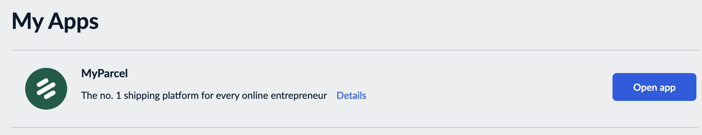
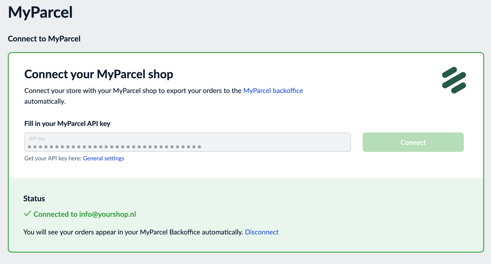
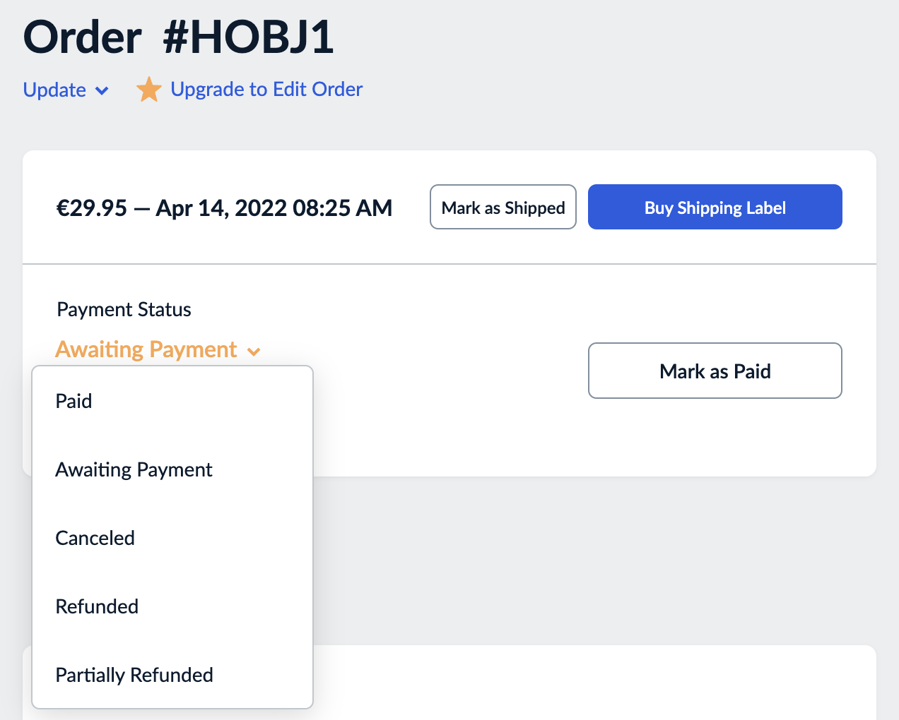

::: tip In breve
Ecwid si collega a MyParcel con l'app gratuita **MyParcel** dell'**Ecwid App Market**. Inserisci una sola volta la tua chiave API MyParcel e da quel momento ogni ordine che in Ecwid passa a **Paid** (Pagato) compare nel tuo back office MyParcel come **spedizione in bozza**. Lì scegli il corriere, il tipo di collo e le opzioni e crei l'etichetta, non in Ecwid. L'app non ha altre impostazioni.
:::

## Avvio rapido, la tua prima etichetta in 10 minuti
Quanto basta per spedire il tuo primo ordine oggi. Per i dettagli, vedi [Cosa stai cercando?](#cosa-stai-cercando) qui sotto.

1. **Account.** Non hai ancora un account MyParcel? Creane uno su [myparcel.nl/register](https://www.myparcel.nl/register).
2. **Copia la chiave API.** Accedi a [backoffice.myparcel.nl](https://backoffice.myparcel.nl) → *Shop settings → Integration* → copia la chiave API.
3. **Installa l'app.** Nell'amministrazione di Ecwid vai su **Apps → App Market**, cerca *MyParcel* e installa l'app gratuita.
4. **Incolla la chiave.** Apri l'app, incolla la chiave in **Fill in your MyParcel API key** e fai clic su **Connect** (Collega).
5. **Stampa un'etichetta.** Imposta un ordine su **Paid**, apri **Shipments** nel tuo back office MyParcel, controlla la spedizione in bozza e crea l'etichetta.

::: tip Hai finito quando vedi questo
- L'app mostra uno stato verde **Connected to** (Collegato a)
- Un ordine Ecwid pagato compare come spedizione in bozza nel tuo back office MyParcel
:::

## Cosa stai cercando?
| Cosa vuoi fare? | Vai a |
| --- | --- |
| Capire cosa fa l'app | [1 · Come funziona il collegamento](#1-come-funziona-il-collegamento) |
| Installare l'app | [2 · Installare l'app](#2-installare-lapp) |
| Collegare il tuo account | [3 · Collegare il tuo account MyParcel](#3-collegare-il-tuo-account-myparcel) |
| Sapere quando un ordine viene inviato | [4 · Quando gli ordini arrivano a MyParcel](#4-quando-gli-ordini-arrivano-a-myparcel) |
| Impostare corriere, tipo di collo e opzioni | [5 · Impostazioni di spedizione](#5-impostazioni-di-spedizione) |
| Vedere cosa vedono i tuoi clienti | [7 · L'esperienza al checkout](#7-lesperienza-al-checkout) |
| Stampare le etichette | [8 · Uso quotidiano](#8-uso-quotidiano) |
| Qualcosa non funziona | [9 · Qualcosa non funziona, diagnostica](#9-qualcosa-non-funziona-diagnostica) |
| Risposta a una domanda frequente | [10 · FAQ](#10-faq) |

## 1 · Come funziona il collegamento
L'app MyParcel collega il tuo negozio Ecwid a un negozio del tuo account MyParcel. Fa una cosa sola: appena un ordine passa a **Paid** (Pagato), l'app lo invia a MyParcel, dove resta in attesa come spedizione in bozza. Da lì lavori nel tuo back office MyParcel: controlli la spedizione, crei l'etichetta e consegni il pacco al corriere.

L'app non aggiunge opzioni di consegna al checkout, non aggiunge impostazioni ai prodotti e non mostra etichette in Ecwid.

::: warning Non è Buy Shipping Label
Il pulsante di Ecwid **Buy Shipping Label** (Acquista etichetta di spedizione) su un ordine non ha nulla a che fare con MyParcel. Per spedire con le tue tariffe MyParcel, crea l'etichetta nel tuo back office MyParcel.
:::

## 2 · Installare l'app
1. Nell'amministrazione di Ecwid apri **Apps → App Market**.
2. Cerca *MyParcel* e apri l'app di MyParcel. È gratuita.
3. Installa l'app e accetta le autorizzazioni che richiede.

Le app installate sono elencate in **Apps → My Apps** (Le mie app). Fai clic su **Open app** accanto a MyParcel per aprire la pagina dell'app. Dopo l'installazione l'app compare anche in **Shipping & Pickup → MyParcel** (Spedizione e ritiro) nel menu a sinistra.

## 3 · Collegare il tuo account MyParcel

1. Copia la tua chiave API da [backoffice.myparcel.nl](https://backoffice.myparcel.nl) sotto *Shop settings → Integration*. Anche il link **General settings** sotto il campo porta al tuo back office MyParcel.
2. Incollala in **Fill in your MyParcel API key**. Attenzione agli spazi prima o dopo la chiave.
3. Fai clic su **Connect** (Collega).

Se la chiave viene accettata, il riquadro **Status** diventa verde con **Connected to** (Collegato a) seguito dal tuo account MyParcel, e la riga *You will see your orders appear in your MyParcel Backoffice automatically* (I tuoi ordini compariranno automaticamente nel back office MyParcel). Se la chiave non viene accettata, lo stato indica **Not connected** (Non collegato).

Per usare un'altra chiave fai clic su **Disconnect** (Scollega). La chiave viene rimossa e puoi inserirne una nuova.

::: warning Una chiave, un negozio
L'app si collega a un solo negozio del tuo account MyParcel. Se il tuo account ha più negozi, usa la chiave API del negozio in cui devono arrivare gli ordini Ecwid. Tutte le etichette e le fatture finiscono in quel negozio.
:::

## 4 · Quando gli ordini arrivano a MyParcel
Un ordine viene inviato a MyParcel nel momento in cui il suo **Payment Status** (Stato del pagamento) diventa **Paid** (Pagato). Con il pagamento online succede in automatico. Per un ordine pagato in altro modo, ad esempio con bonifico, imposta tu lo stato: apri l'ordine e fai clic su **Mark as Paid** (Segna come pagato), oppure scegli **Paid** nel menu *Payment Status*.

Gli ordini ancora in *Awaiting Payment* (In attesa di pagamento), annullati o rimborsati non vengono inviati.

## 5 · Impostazioni di spedizione
L'app non ha impostazioni di spedizione proprie. Tutto ciò che riguarda il pacco si decide nel tuo back office MyParcel:

- **I valori predefiniti.** Ogni spedizione in bozza parte con il corriere, il tipo di collo e le opzioni predefiniti del negozio a cui è collegata l'app. Li imposti nel tuo back office MyParcel in *Shop settings*.
- **Per spedizione.** Prima di creare un'etichetta puoi modificare corriere, tipo di collo, opzioni e assicurazione direttamente sulla spedizione in bozza.

I corrieri e le opzioni disponibili dipendono dal tuo contratto MyParcel.

## 6 · Impostazioni prodotto
Questa app non aggiunge opzioni a livello di prodotto. Tutto ciò che riguarda la spedizione si gestisce dal tuo back office MyParcel.

## 7 · L'esperienza al checkout
L'app non modifica il checkout di Ecwid. I tuoi clienti scelgono tra i metodi di spedizione che hai configurato in Ecwid in **Shipping & Pickup**, come una tariffa fissa o la spedizione gratuita. Il metodo scelto non viene riportato come corriere o opzione di consegna: li scegli tu sulla spedizione in bozza in MyParcel.

## 8 · Uso quotidiano
1. Arriva un ordine e passa a **Paid** ([§4](#4-quando-gli-ordini-arrivano-a-myparcel)).
2. Nel tuo back office MyParcel apri **Shipments**. L'ordine è lì come **spedizione in bozza**.
3. Controlla indirizzo, corriere, tipo di collo e peso. Fai clic sulla matita accanto alla spedizione per modificare qualcosa.
4. Crea l'etichetta, stampala e consegna il pacco al corriere. Puoi farlo per una spedizione alla volta oppure selezionarne diverse e creare le etichette in una sola volta.

L'app non riporta il codice Track & Trace in Ecwid. Per permettere al cliente di seguire il pacco, condividi il link Track & Trace da MyParcel oppure aggiungilo all'ordine in Ecwid con **Add tracking number** (Aggiungi numero di tracciamento).

Paghi una spedizione solo quando viene effettivamente consegnata al corriere.

## 9 · Qualcosa non funziona, diagnostica
Scorri questa tabella dall'alto verso il basso, la maggior parte dei problemi si risolve in pochi minuti.

| Sintomo | Cosa controllare |
| --- | --- |
| **Lo stato indica Not connected** | La **chiave API** è corretta, senza spazi? Copiala di nuovo dal tuo back office MyParcel e fai clic su **Connect** ([§3](#3-collegare-il-tuo-account-myparcel)). |
| **Un ordine pagato non arriva in MyParcel** | L'ordine è davvero su **Paid**? Per inviarlo di nuovo, riporta lo stato del pagamento su *Awaiting Payment* e poi di nuovo su **Paid** ([§4](#4-quando-gli-ordini-arrivano-a-myparcel)). |
| **Gli ordini arrivano nel negozio MyParcel sbagliato** | L'app è collegata al negozio a cui appartiene la chiave API. Fai clic su **Disconnect** e collega di nuovo con la chiave del negozio giusto ([§3](#3-collegare-il-tuo-account-myparcel)). |
| **Non arriva nessun ordine** | Rimuovi l'app in **Apps → My Apps**, installala di nuovo e ricollegala con la tua chiave API ([§2](#2-installare-lapp)). |
| **Il peso o il valore della bozza sembrano sbagliati** | Controlla il peso dei tuoi prodotti in Ecwid e correggi la spedizione in bozza prima di creare l'etichetta ([§8](#8-uso-quotidiano)). |

## 10 · FAQ

### Dove trovo la mia chiave API?
In [backoffice.myparcel.nl](https://backoffice.myparcel.nl) sotto *Shop settings → Integration*.

### Dove stampo le etichette?
Nel tuo back office MyParcel, in **Shipments**. I tuoi ordini Ecwid ti aspettano lì come spedizioni in bozza.

### Posso scegliere il corriere per ogni ordine?
Sì, sulla spedizione in bozza nel tuo back office MyParcel, prima di creare l'etichetta. I corrieri disponibili dipendono dal tuo contratto MyParcel.

### I miei clienti possono scegliere un giorno di consegna o un punto di ritiro al checkout?
No. L'app non aggiunge opzioni di consegna al checkout di Ecwid.

### Posso impostare le opzioni di spedizione per prodotto?
No. Imposta i valori predefiniti nel tuo back office MyParcel e modifica una singola spedizione sulla bozza.

### Come collego un altro negozio MyParcel?
Fai clic su **Disconnect** nella pagina dell'app e collega di nuovo con la chiave API dell'altro negozio.

### Quando mi viene addebitato?
MyParcel fattura una spedizione solo quando viene effettivamente consegnata al corriere.

## Risorse e supporto
- [backoffice.myparcel.nl ↗](https://backoffice.myparcel.nl), account, chiave API, corrieri e fatturazione.
- [MyParcel nell'Ecwid App Market ↗](https://www.ecwid.com/apps/shipping/myparcel/).
- [Contatta il supporto MyParcel](../../contact.md), **023 - 30 30 315** · [info@myparcel.nl](mailto:info@myparcel.nl).

Questa guida descrive l'app MyParcel per Ecwid così come funziona a ottobre 2026.
