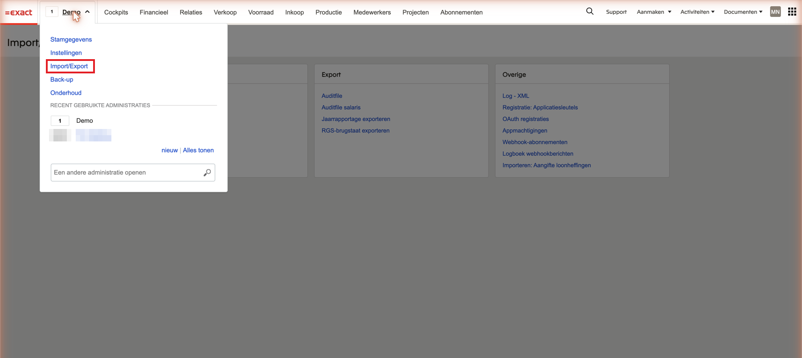
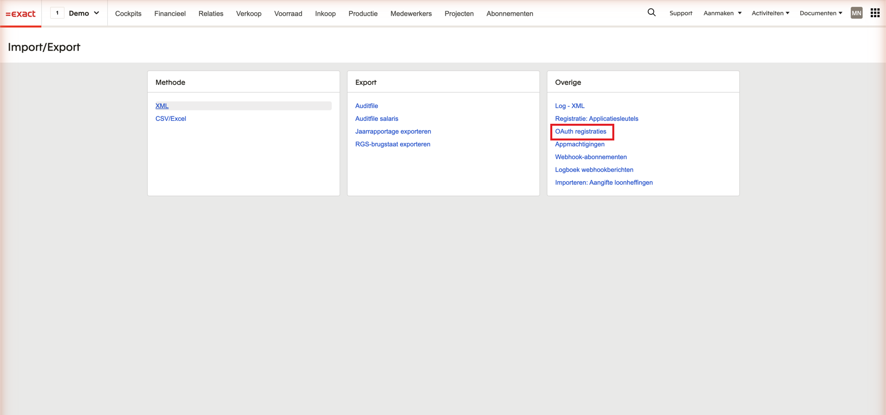
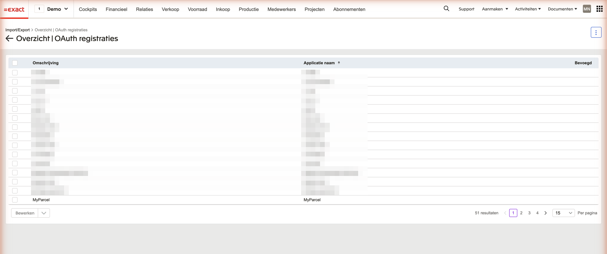
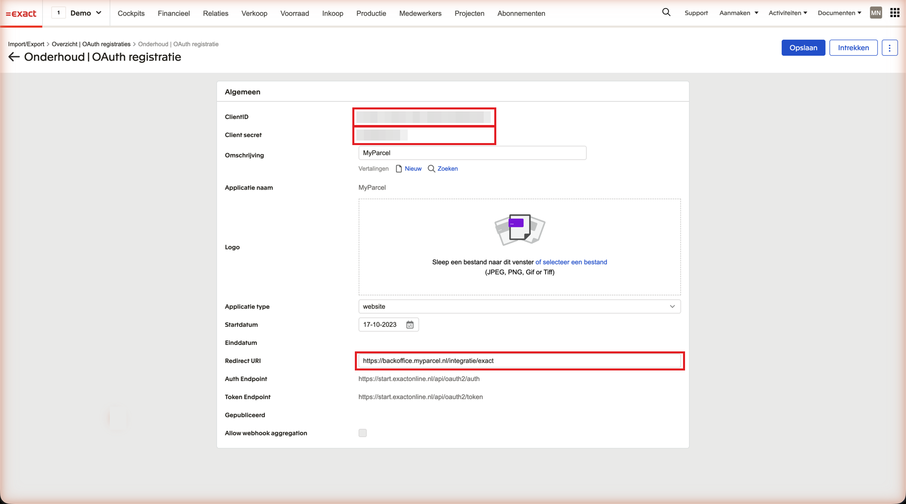

::: tip In breve
Exact Online si collega a MyParcel dalla pagina **Integration** del tuo back office MyParcel, senza installare nulla. Registri una sola volta un'app MyParcel in Exact Online e copi il suo **Client ID** e il suo **Client secret** in MyParcel. Poi importi con un clic le consegne merci aperte da Exact Online. Arrivano come **spedizioni in bozza** e crei le etichette nel back office MyParcel. MyParcel scrive il codice a barre nella consegna merci in Exact Online. Per questo collegamento ti serve il modulo Exact Online *Handel*.
:::

## Avvio rapido, le tue prime consegne in 10 minuti
Quanto basta per collegare Exact Online a MyParcel oggi. Per i dettagli, vedi [Cosa stai cercando?](#cosa-stai-cercando) qui sotto.

1. **Account.** Non hai ancora un account MyParcel? Creane uno su [myparcel.nl/register](https://www.myparcel.nl/register).
2. **Registra l'app.** In Exact Online fai clic sul nome della tua amministrazione → **Import/Export** → **OAuth registraties** → **Nieuw**. Accetta le condizioni e inserisci la redirect URI `https://backoffice.myparcel.nl/integratie/exact`.
3. **Copia le chiavi.** Salva la registrazione e copia il **Client ID** e il **Client secret**.
4. **Incolla le chiavi.** In [backoffice.myparcel.nl](https://backoffice.myparcel.nl) vai su *Shop settings → Integration*, scorri fino a **External links**, apri **Exact Online**, incolla le due chiavi e salva.
5. **Importa le consegne.** Nella panoramica *Shipments* fai clic su **Import external orders**, seleziona le consegne merci e importale.

::: tip Hai finito quando vedi questo
- L'app MyParcel nell'elenco in **OAuth registraties** in Exact Online
- Le tue nuove consegne merci come spedizioni in bozza nella panoramica *Shipments*
:::

## Cosa stai cercando?
| Cosa vuoi fare? | Vai a |
| --- | --- |
| Capire come funziona il collegamento | [1 · Come funziona il collegamento](#1-come-funziona-il-collegamento) |
| Registrare l'app MyParcel in Exact Online | [2 · Registrare l'app in Exact Online](#2-registrare-lapp-in-exact-online) |
| Collegare Exact Online al tuo account MyParcel | [3 · Collegare MyParcel](#3-collegare-myparcel) |
| Importare consegne e stampare etichette | [4 · Uso quotidiano](#4-uso-quotidiano) |
| Sapere come funzionano gli aggiornamenti | [5 · Aggiornamenti](#5-aggiornamenti) |
| Qualcosa non funziona | [6 · Qualcosa non funziona, diagnostica](#6-qualcosa-non-funziona-diagnostica) |
| Risposta a una domanda frequente | [7 · FAQ](#7-faq) |

## 1 · Come funziona il collegamento
Exact Online è un software di contabilità, quindi non c'è un plugin da installare. Registri un'app per MyParcel nella tua amministrazione Exact Online. Così ottieni un Client ID e un Client secret. Li inserisci entrambi nel back office MyParcel, e MyParcel legge poi le tue consegne merci (*goederenleveringen*) da Exact Online.

Recuperi tu stesso le consegne merci aperte, che arrivano in MyParcel come spedizioni in bozza. Crei le etichette nel back office MyParcel e MyParcel scrive il codice a barre nella consegna merci in Exact Online.

::: warning Ti serve il modulo Handel
Il collegamento funziona con le consegne merci, che fanno parte del modulo Exact Online *Handel*. Senza questo modulo MyParcel non ha nulla da importare. Se non hai il modulo, chiedi informazioni a Exact Online.
:::

Le schermate lato Exact Online in questa guida sono in olandese. Exact Online le mostra nella lingua del tuo account.

## 2 · Registrare l'app in Exact Online
Da aprile 2026 le app non si trovano più nell'Exact App Store. Registri l'app MyParcel nella tua amministrazione Exact Online, in **OAuth registraties**.

::: warning Ti serve il diritto Apps beheren
Solo un utente con il diritto **Apps beheren** (gestire le app) può registrare un'app. Se non vedi i passaggi qui sotto, chiedi all'amministratore del tuo account Exact Online.
:::

1. Accedi a Exact Online. Fai clic sul nome della tua amministrazione in alto nella pagina e scegli **Import/Export**.

2. Nella colonna **Overige** fai clic su **OAuth registraties**.

3. Vedi la panoramica delle registrazioni delle app. Fai clic su **Nieuw** per registrare una nuova app per MyParcel.

4. Spunta la casella per accettare le condizioni e fai clic su **Accepteren**.
5. Compila la registrazione:

   | Campo | Cosa inserire |
   | --- | --- |
   | **Applicatienaam** | Un nome univoco per l'app MyParcel, ad esempio *MyParcel* seguito dal nome del tuo negozio. |
   | **Redirect URI** | `https://backoffice.myparcel.nl/integratie/exact` |
   | **Omschrijving** | Una breve descrizione, ad esempio *MyParcel*. |

6. Salva la registrazione. In alto nella pagina ora vedi un **ClientID** e un **Client secret**. Copiali entrambi, ti servono nel [§3](#3-collegare-myparcel).

::: warning Tieni per te il Client secret
Insieme, Client ID e Client secret danno accesso alla tua amministrazione Exact Online. Incollali solo nel back office MyParcel, mai in un'e-mail o in una chat.
:::

## 3 · Collegare MyParcel
1. Accedi a [backoffice.myparcel.nl](https://backoffice.myparcel.nl) e vai su **Shop settings → Integration**.
2. Scorri fino a **External links** e apri **Exact Online** con il pulsante **+**.
3. Incolla il **Client ID** e il **Client secret** del [§2](#2-registrare-lapp-in-exact-online). Attenzione agli spazi prima o dopo le chiavi.
4. Salva. Se Exact Online ti chiede di accedere e di dare l'autorizzazione a MyParcel, fallo con l'account dell'amministrazione in cui hai registrato l'app.

Il collegamento è pronto all'uso.

## 4 · Uso quotidiano
1. Nel back office MyParcel apri la panoramica **Shipments** e fai clic su **Import external orders**.
2. Compare l'elenco delle consegne merci aperte in Exact Online. Importale una alla volta con **Import**, oppure selezionane diverse e importale in una volta.
3. Una consegna importata riceve un segno di spunta verde. Le consegne arrivano come **spedizioni in bozza**. Fai clic sulla matita accanto a una spedizione per modificarla, ad esempio il tipo di collo o le opzioni di consegna.
4. Crea le etichette e consegna i colli al corriere.

Non appena la spedizione è registrata presso il corriere, MyParcel scrive il codice a barre nel campo **Trackingnummer** della consegna merci in Exact Online.

::: warning Solo le nuove consegne
MyParcel importa solo le consegne merci che crei dopo aver collegato Exact Online. Le consegne merci precedenti al collegamento non vengono recuperate.
:::

Paghi una spedizione solo quando è stata effettivamente consegnata al corriere.

## 5 · Aggiornamenti
Il collegamento funziona nel back office MyParcel, quindi non devi aggiornare nulla. Usi sempre l'ultima versione.

## 6 · Qualcosa non funziona, diagnostica
Scorri questa tabella dall'alto verso il basso, la maggior parte dei problemi si risolve in pochi minuti.

| Sintomo | Cosa controllare |
| --- | --- |
| **Non vedi OAuth registraties o il pulsante Nieuw** | Il tuo utente Exact Online ha bisogno del diritto **Apps beheren**. Chiedi all'amministratore del tuo account Exact Online ([§2](#2-registrare-lapp-in-exact-online)). |
| **Exact Online rifiuta il collegamento** | La **Redirect URI** è esattamente `https://backoffice.myparcel.nl/integratie/exact`? **Client ID** e **Client secret** sono corretti, senza spazi? Copiali di nuovo dalla registrazione in Exact Online ([§2](#2-registrare-lapp-in-exact-online)). |
| **Nessuna consegna compare durante l'importazione** | Vengono importate solo le consegne merci create dopo il collegamento ([§4](#4-uso-quotidiano)). Hai il modulo *Handel*? ([§1](#1-come-funziona-il-collegamento)) |
| **Una consegna mostra un triangolo rosso durante l'importazione** | L'indirizzo di consegna probabilmente è incompleto o errato. Correggi l'indirizzo in Exact Online e importa di nuovo la consegna merci. |
| **Il codice a barre non compare in Exact Online** | Il codice a barre viene inviato non appena la spedizione è registrata presso il corriere. Controlla il campo **Trackingnummer** della consegna merci. |

## 7 · FAQ

### Devo installare qualcosa?
No. Exact Online si collega dal back office MyParcel, non c'è un plugin né un'app da installare. Registri solo un'app in Exact Online ([§2](#2-registrare-lapp-in-exact-online)).

### Di quale modulo Exact Online ho bisogno?
Del modulo *Handel*. Il collegamento importa consegne merci, che fanno parte di quel modulo.

### MyParcel si trova ancora nell'Exact App Store?
No. Da aprile 2026 registri tu l'app in Exact Online, in *Import/Export → OAuth registraties* ([§2](#2-registrare-lapp-in-exact-online)).

### Le consegne vengono importate automaticamente?
No. Recuperi tu le consegne merci aperte con **Import external orders** nella panoramica *Shipments*.

### Il codice a barre torna in Exact Online?
Sì. Non appena la spedizione è registrata presso il corriere, MyParcel scrive il codice a barre nel campo **Trackingnummer** della consegna merci.

## Risorse e supporto
- [backoffice.myparcel.nl ↗](https://backoffice.myparcel.nl), integrazione, spedizioni, account e fatturazione.
- [Exact Online ↗](https://www.exact.com/nl/).
- [Contatta il supporto MyParcel](../../contact.md), **023 - 30 30 315** · [info@myparcel.nl](mailto:info@myparcel.nl).

Questa guida descrive il collegamento Exact Online nel back office MyParcel così come funziona a novembre 2026.
