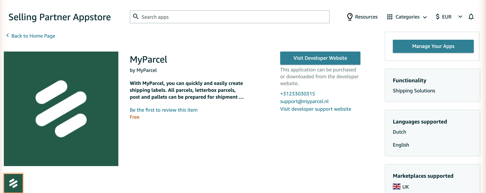
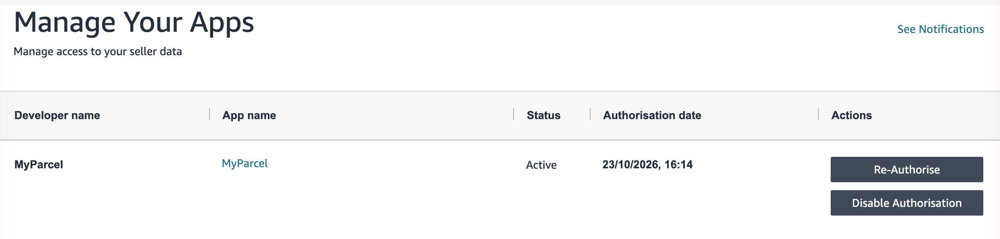
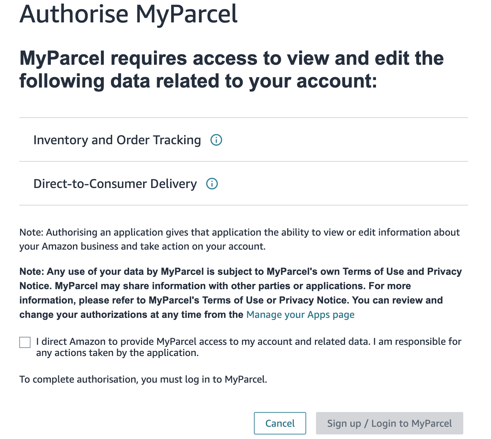

::: tip In het kort
Amazon koppel je aan MyParcel met de **MyParcel-app** in Amazon Seller Central. Je autoriseert de app in Seller Central, logt in bij MyParcel en kiest de MyParcel-shop die je orders ontvangt. MyParcel maakt dan een **Amazon-verkoopkanaal** (sales channel) aan voor die shop. Vanaf dat moment verschijnen je nieuwe Amazon-orders vanzelf in MyParcel, verstuur je ze vanuit je MyParcel-backoffice, en stuurt MyParcel de barcode en de vervoerder terug naar Amazon.
:::

## Snelstart, je eerste Amazon-orders in 10 minuten
Genoeg om Amazon vandaag aan MyParcel te koppelen. Voor de details, zie [Wat zoek je?](#wat-zoek-je) hieronder.

1. **Account.** Heb je nog geen MyParcel-account? Maak er een aan via [myparcel.nl/register](https://www.myparcel.nl/register). Zet **tweestapsverificatie** aan in je MyParcel-account voordat je begint ([§2](#2-voordat-je-begint)).
2. **App zoeken.** Log in op Amazon Seller Central, open de **Selling Partner Appstore** en zoek op **MyParcel**.
3. **App autoriseren.** Klik op **Manage Your Apps** (Je apps beheren) en autoriseer MyParcel. Vink het vakje aan om MyParcel toegang te geven en klik op **Sign up / Login to MyParcel** (Aanmelden / inloggen bij MyParcel).
4. **Inloggen bij MyParcel.** Amazon stuurt je door naar MyParcel. Log in met je MyParcel-account.
5. **Shop kiezen.** Selecteer de MyParcel-shop die je Amazon-orders ontvangt, vink de bevestiging aan en klik op **Approve and connect** (Goedkeuren en koppelen).
6. **Bevestigen bij Amazon.** Amazon vraagt je nog één keer om de toegang te bevestigen. Bevestig die.

::: tip Klaar als je dit ziet
- De pagina **Connection successful** (Koppeling gelukt) met de melding *Your Amazon store is now connected to MyParcel.*
- Een Amazon-verkoopkanaal bij je MyParcel-shop
- **MyParcel** met de status *Active* (Actief) onder *Manage Your Apps* in Seller Central
- Nieuwe, nog niet verzonden Amazon-orders in je MyParcel-backoffice
:::

## Wat zoek je?
| Wat wil je doen? | Ga naar |
| --- | --- |
| Begrijpen hoe de koppeling werkt | [1 · Hoe de koppeling werkt](#1-hoe-de-koppeling-werkt) |
| Controleren wat je eerst nodig hebt | [2 · Voordat je begint](#2-voordat-je-begint) |
| De app installeren en toegang geven | [3 · Amazon stap voor stap koppelen](#3-amazon-stap-voor-stap-koppelen) |
| Weten wat MyParcel met je account mag doen | [4 · Waar je toestemming voor geeft](#4-waar-je-toestemming-voor-geeft) |
| Je Amazon-orders versturen | [5 · Dagelijks gebruik](#5-dagelijks-gebruik) |
| Opnieuw koppelen of de koppeling verbreken | [6 · Opnieuw koppelen en verbreken](#6-opnieuw-koppelen-en-verbreken) |
| Er werkt iets niet | [7 · Er werkt iets niet, diagnose](#7-er-werkt-iets-niet-diagnose) |
| Antwoord op een veelgestelde vraag | [8 · FAQ](#8-faq) |

## 1 · Hoe de koppeling werkt
Amazon is een marktplaats, dus er is geen plugin voor je webshop. Je koppelt in plaats daarvan vanaf de kant van Amazon. Je autoriseert de MyParcel-app in Amazon Seller Central, en Amazon geeft MyParcel toegang tot je orders.

De koppeling is een **verkoopkanaal** bij je MyParcel-shop. Je maakt het niet zelf aan in de backoffice: MyParcel maakt het aan aan het eind van het koppelen, met de shop en de naam die jij kiest.

Daarna werkt de koppeling vanzelf:

- Krijgt een Amazon-order de status **Unshipped** (Niet verzonden), dan laat Amazon dat aan MyParcel weten. MyParcel haalt de order op en zet hem in je MyParcel-backoffice.
- Je verstuurt de order vanuit MyParcel.
- MyParcel stuurt de barcode en de vervoerder terug naar Amazon en bevestigt de verzending.

Je hoeft geen besteloverzichten te downloaden of bestanden te uploaden.

## 2 · Voordat je begint
Controleer deze punten voordat je koppelt. Ontbreekt er één, dan lukt het koppelen niet.

| Wat je nodig hebt | Waarom |
| --- | --- |
| **Een Amazon-verkopersaccount met een Professional-verkoopabonnement** | Amazon laat apps alleen koppelen met accounts die een Professional-abonnement hebben. |
| **Een MyParcel-account met orderbeheer** | Je Amazon-orders komen in MyParcel binnen als orders. Zonder orderbeheer toont MyParcel *Your MyParcel account does not support order management.* Neem contact op met MyParcel support om het aan te zetten. |
| **Tweestapsverificatie op je MyParcel-account** | MyParcel koppelt Amazon alleen voor accounts die tweestapsverificatie gebruiken. |
| **Toegang tot de MyParcel-shop** | Je kunt Amazon alleen koppelen aan een shop waar jouw MyParcel-gebruiker toegang toe heeft. |

Zo zet je tweestapsverificatie aan:

1. Log in op [backoffice.myparcel.nl](https://backoffice.myparcel.nl).
2. Klik op **Account Settings** (Accountinstellingen).
3. Ga naar **Users & security** (Gebruikers en beveiliging).
4. Zet onder **Security** (Beveiliging) **Two-factor authentication** (Tweestapsverificatie) aan.

## 3 · Amazon stap voor stap koppelen
Doorloop deze stappen in één keer. Het koppelen moet klaar zijn binnen 5 minuten nadat je bij MyParcel bent ingelogd. Duurt het langer, begin dan opnieuw vanuit Seller Central.

### De app installeren in Seller Central
1. Log in op **Amazon Seller Central** met het account van je Amazon-shop.
2. Open de **Selling Partner Appstore** en zoek op **MyParcel**. De app is van MyParcel en is gratis.

3. Klik op **Manage Your Apps** (Je apps beheren) en autoriseer MyParcel. Heb je al eens gekoppeld? Klik dan op **Re-Authorise** (Opnieuw autoriseren) naast MyParcel.

4. Amazon toont de pagina **Authorise MyParcel** (MyParcel autoriseren) met de gegevens die MyParcel nodig heeft, zie [§4](#4-waar-je-toestemming-voor-geeft). Vink **I direct Amazon to provide MyParcel access to my account and related data.** aan (Ik geef Amazon opdracht MyParcel toegang te geven tot mijn account en de bijbehorende gegevens).
5. Klik op **Sign up / Login to MyParcel** (Aanmelden / inloggen bij MyParcel).

### Inloggen bij MyParcel
6. Amazon stuurt je door naar MyParcel. Log in met je MyParcel-account. MyParcel vraagt om je code voor tweestapsverificatie.

### De shop kiezen
7. MyParcel toont de pagina **Connect your Amazon account to MyParcel** (Koppel je Amazon-account aan MyParcel).
8. Selecteer onder **Shop to connect** (Te koppelen shop) de MyParcel-shop die je Amazon-orders ontvangt.
9. Vul onder **New sales channel name** (Naam nieuw verkoopkanaal) een naam in waaraan je het kanaal herkent, bijvoorbeeld *Amazon NL*. Gebruik 3 tot 50 tekens, zonder spatie aan het begin of eind.
10. Lees de rechten onder **What you allow** (Waar je toestemming voor geeft), zie [§4](#4-waar-je-toestemming-voor-geeft).
11. Vink **I want to connect this Amazon account to the shop I selected.** aan (Ik wil dit Amazon-account koppelen aan de shop die ik heb gekozen).
12. Klik op **Approve and connect** (Goedkeuren en koppelen).

::: tip Maar één shop?
Heeft je MyParcel-gebruiker toegang tot maar één shop, dan slaat MyParcel deze pagina over. Het verkoopkanaal komt dan bij die shop, met de naam *Amazon*.
:::

### Bevestigen bij Amazon
13. MyParcel stuurt je terug naar Amazon. Amazon vraagt je nog één keer om de toegang te bevestigen. Bevestig die.
14. Je ziet de pagina **Connection successful** (Koppeling gelukt). Je kunt het venster sluiten.

Amazon vraagt twee keer om je toestemming: één keer voordat je naar MyParcel gaat, en één keer nadat je de shop hebt gekozen. Beide stappen zijn nodig.

::: warning Cancel of Deny om te stoppen
Wil je stoppen? Klik op **Cancel** (Annuleren) op de pagina van Amazon, of op **Deny** (Weigeren) op de pagina van MyParcel. Op de pagina van MyParcel zie je dan **Connection cancelled** (Koppeling geannuleerd). Er is niets gekoppeld.
:::

## 4 · Waar je toestemming voor geeft
Op de Amazon-pagina **Authorise MyParcel** vraagt MyParcel toegang tot deze gegevens in je verkopersaccount:

| Gegevens | Waarom MyParcel ze nodig heeft |
| --- | --- |
| **Inventory and Order Tracking** (Voorraad en ordertracking) | Om je orders te lezen en de barcode terug te sturen. |
| **Direct-to-Consumer Delivery** (Levering rechtstreeks aan de klant) | Om het afleveradres van je koper te lezen. |

Op de pagina van MyParcel geef je MyParcel toestemming om:

| Recht | Wat MyParcel ermee doet |
| --- | --- |
| **Read your Amazon orders and their details** (Je Amazon-orders en hun details lezen) | Elke niet-verzonden order ophalen, met de artikelen en het afleveradres. |
| **Create and update the matching orders in MyParcel** (De bijbehorende orders in MyParcel aanmaken en bijwerken) | De Amazon-order in je MyParcel-shop zetten en actueel houden. |

Om de barcode terug te sturen bevestigt MyParcel ook de verzending van de order bij Amazon, zie [§5](#5-dagelijks-gebruik).

## 5 · Dagelijks gebruik
1. Een koper bestelt op Amazon. Heeft de order de status **Unshipped** (Niet verzonden), dan komt hij vanzelf in je MyParcel-backoffice binnen, meestal binnen een paar minuten.
2. Open de order in je MyParcel-backoffice en maak de zending en het label aan.
3. Geef het pakket mee aan de vervoerder.

Zijn de orderregels verzonden, dan bevestigt MyParcel de verzending bij Amazon met de barcode en de vervoerder. Amazon toont de order dan als verzonden, met het trackingnummer.

::: warning Bevestig de verzending niet zelf in Amazon
Verstuur je Amazon-orders vanuit MyParcel. Bevestig je de verzending met de hand in Seller Central, dan heeft Amazon al eigen trackinggegevens en kan MyParcel de barcode niet toevoegen.
:::

Orders die al verzonden waren voordat je koppelde, worden niet geïmporteerd. Alleen orders die na het koppelen de status **Unshipped** krijgen, komen in MyParcel binnen.

Je betaalt pas voor een zending als die echt aan de vervoerder is overgedragen.

## 6 · Opnieuw koppelen en verbreken
### Opnieuw koppelen
Je kunt het koppelen altijd opnieuw doorlopen vanuit Seller Central, bijvoorbeeld nadat je de app hebt verwijderd. Is het Amazon-account al gekoppeld, dan slaat MyParcel de shoppagina over en gebruikt het de shop en de naam van het bestaande verkoopkanaal.

Eén Amazon-account koppel je aan één MyParcel-shop. Is het Amazon-account al gekoppeld aan een shop waar jouw MyParcel-gebruiker geen toegang toe heeft, dan mislukt het koppelen, zie [§7](#7-er-werkt-iets-niet-diagnose).

### Koppeling verbreken
Je kunt de koppeling op twee plekken beëindigen:

- **In MyParcel.** Ga in je MyParcel-backoffice naar *Shop settings → Sales Channels* (Shopinstellingen → Verkoopkanalen) en verwijder het Amazon-verkoopkanaal.
- **In Amazon.** Ga in Seller Central naar *Manage Your Apps* (Je apps beheren) en klik op **Disable Authorisation** (Autorisatie uitschakelen) naast MyParcel.

Na het verbreken komen nieuwe Amazon-orders niet meer in MyParcel binnen. Orders die al in MyParcel staan, blijven daar staan.

## 7 · Er werkt iets niet, diagnose
Loop deze tabel van boven naar beneden door, de meeste problemen zijn binnen een paar minuten opgelost. MyParcel toont de **vetgedrukte** melding op de pagina **Connection failed** (Koppelen mislukt).

| Symptoom | Wat te controleren |
| --- | --- |
| **Two-factor authentication required** | Zet tweestapsverificatie aan in je MyParcel-account ([§2](#2-voordat-je-begint)). Sluit daarna het venster en begin opnieuw vanuit Seller Central. |
| **Your MyParcel account does not support order management.** | Je account heeft geen orderbeheer. Neem contact op met MyParcel support. |
| **Your session has expired.** | Je deed er langer dan 5 minuten over na het inloggen bij MyParcel. Sluit het venster en begin opnieuw vanuit Seller Central. |
| **This Amazon account is already connected to a MyParcel shop that you do not have access to.** | Log in bij MyParcel met een gebruiker die toegang heeft tot die shop, of vraag de eigenaar van het account om eerst het bestaande Amazon-verkoopkanaal te verwijderen. |
| **Amazon could not authorize this connection.** | Amazon heeft de autorisatie geweigerd. Sluit het venster en begin opnieuw vanuit Seller Central. Controleer dat je bij Amazon bent ingelogd met het juiste verkopersaccount. |
| **We could not finish setting up order notifications.** | Amazon heeft de ordermeldingen niet geaccepteerd. Sluit het venster en begin opnieuw. Er is niets opgeslagen, dus je kunt het veilig nog eens proberen. |
| **Er komen geen Amazon-orders binnen in MyParcel** | Alleen orders met de status *Unshipped* komen binnen. Controleer de status in Seller Central. Controleer dat MyParcel de status *Active* heeft onder *Manage Your Apps* en dat het verkoopkanaal nog bij je shop staat ([§6](#6-opnieuw-koppelen-en-verbreken)). |
| **De barcode verschijnt niet in Amazon** | Heb je de verzending zelf in Seller Central bevestigd voordat je hem vanuit MyParcel verstuurde ([§5](#5-dagelijks-gebruik))? |

## 8 · FAQ

### Moet ik iets installeren?
Je installeert alleen de MyParcel-app in Amazon Seller Central. In je webshop of op je computer hoef je niets te installeren.

### Kan ik het koppelen starten vanuit de MyParcel-backoffice?
Nee. Het koppelen begint altijd in Amazon Seller Central. MyParcel maakt het verkoopkanaal voor je aan aan het eind van het koppelen.

### Worden orders automatisch geïmporteerd?
Ja. Elke order die de status *Unshipped* krijgt, komt vanzelf in MyParcel binnen. Je hoeft niet op importeren te klikken of een bestand te uploaden.

### Sturen jullie de barcode terug naar Amazon?
Ja. Verstuur je de order vanuit MyParcel, dan bevestigt MyParcel de verzending bij Amazon met de barcode en de vervoerder.

### Kan ik meer dan één Amazon-account koppelen?
Ja, maar elk Amazon-account koppel je aan één MyParcel-shop. Koppel het tweede account aan een andere shop.

### Heb ik het besteloverzicht uit Seller Central nog nodig?
Nee. De oude manier van koppelen, waarbij je het overzicht *Niet-verzonden bestellingen* downloadde en in MyParcel uploadde, is vervangen door deze app.

### Hoe stop ik de koppeling?
Verwijder het Amazon-verkoopkanaal in je MyParcel-backoffice, of klik op **Disable Authorisation** naast MyParcel onder *Manage Your Apps* in Seller Central ([§6](#6-opnieuw-koppelen-en-verbreken)).

## Bronnen & support
- [backoffice.myparcel.nl ↗](https://backoffice.myparcel.nl), verkoopkanalen, orders, account en facturatie.
- [Amazon-orders verzenden met MyParcel ↗](https://www.myparcel.nl/en/integrations/amazon/).
- [Contact MyParcel support](../../contact.md), **023 - 30 30 315** · [info@myparcel.nl](mailto:info@myparcel.nl).

Deze handleiding beschrijft de MyParcel-app voor Amazon zoals die werkt in oktober 2026. Schermen aan de kant van Amazon kunnen per accounttaal en marktplaats iets verschillen.
