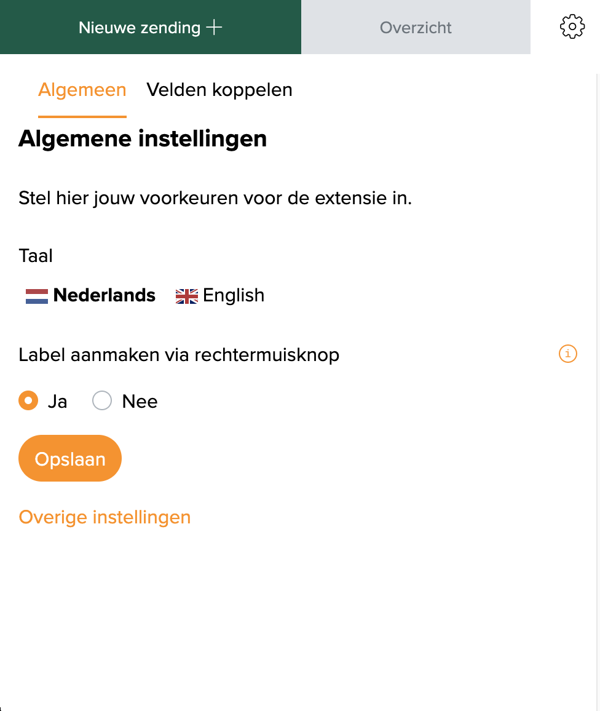

::: tip In het kort
Met de **MyParcel**-extensie voor Google Chrome maak je zendingen vanaf elke webpagina. Je hebt geen plugin nodig: open een order in je shop of marktplaats, klik op het MyParcel-icoon, en het adres staat al ingevuld in een MyParcel-zendingformulier. Je koppelt de adresvelden van een website één keer, of je selecteert een adres op de pagina en maakt met de rechtermuisknop een label. De zending komt in je MyParcel-account terecht, net als elke andere zending.
:::

## Snelstart, je eerste label in 10 minuten
Genoeg om vandaag je eerste order te verzenden. Voor de details, zie [Wat zoek je?](#wat-zoek-je) hieronder.

1. **Account.** Heb je nog geen MyParcel-account? Maak er een aan via [myparcel.nl/register](https://www.myparcel.nl/register).
2. **Extensie installeren.** Open [MyParcel in de Chrome Web Store](https://chromewebstore.google.com/detail/myparcel/ncomggonlkegodkmolbbepaebmoikbph) en klik op **Toevoegen aan Chrome**.
3. **Vastzetten.** Klik op het puzzelstukje rechtsboven in Chrome en zet **MyParcel** vast.
4. **Inloggen.** Klik op het MyParcel-icoon en log in met je MyParcel-account.
5. **Label maken.** Selecteer een adres op een pagina, klik met de rechtermuisknop en kies **Label aanmaken van selectie**. Controleer de zending in het venster dat opent en sla hem op.

::: tip Klaar als je dit ziet
- Het MyParcel-venster opent naast je browser als je op het icoon klikt
- Het geselecteerde adres staat in het zendingformulier
- De zending staat onder **Overzicht** en in je MyParcel-backoffice
:::

## Wat zoek je?
| Wat wil je doen? | Ga naar |
| --- | --- |
| Begrijpen wat de extensie doet | [1 · Hoe de extensie werkt](#1-hoe-de-extensie-werkt) |
| De extensie installeren en inloggen | [2 · Installeren en inloggen](#2-installeren-en-inloggen) |
| De taal of de rechtermuisklik-optie wijzigen | [3 · Algemene instellingen](#3-algemene-instellingen) |
| Het adres in je shop automatisch laten invullen | [4 · Velden koppelen](#4-velden-koppelen) |
| Een zending maken vanaf een orderpagina | [5 · Een zending maken](#5-een-zending-maken) |
| Een label maken van geselecteerde tekst | [6 · Een label maken met de rechtermuisknop](#6-een-label-maken-met-de-rechtermuisknop) |
| Er werkt iets niet | [7 · Er werkt iets niet, diagnose](#7-er-werkt-iets-niet-diagnose) |
| Antwoord op een veelgestelde vraag | [8 · FAQ](#8-faq) |

## 1 · Hoe de extensie werkt
De extensie is een klein MyParcel-venster dat naast je browser opent. Het leest het adres van de pagina waarop je bent en vult het in op een MyParcel-zendingformulier. Daarna controleer je de zending, kies je de vervoerder en opties, en sla je hem op. Er wordt geen zending gemaakt zonder dat je hem eerst ziet.

Er zijn twee manieren om het adres in het formulier te krijgen:

| Manier | Wanneer gebruiken |
| --- | --- |
| **Velden koppelen** | Je verzendt elke dag vanaf dezelfde website, bijvoorbeeld de orderpagina van je eigen shop. Je koppelt elk adresveld één keer, en daarna vult het formulier zichzelf. |
| **Rechtermuisklik op een selectie** | Je verzendt af en toe, of vanaf een website met wisselende opmaak. Selecteer het adres, klik met de rechtermuisknop en de extensie leest het uit. |

De zendingen die je maakt komen in je MyParcel-account, waar je ze kunt printen, ook in één keer.

## 2 · Installeren en inloggen
1. Open [MyParcel in de Chrome Web Store](https://chromewebstore.google.com/detail/myparcel/ncomggonlkegodkmolbbepaebmoikbph). Je vindt de extensie ook op de MyParcel-website bij de koppeling Google Chrome-extensie.
2. Klik op **Toevoegen aan Chrome** en bevestig.
3. Klik op het puzzelstukje rechtsboven in Chrome en zet **MyParcel** vast, zodat het icoon altijd zichtbaar is.
4. Klik op het MyParcel-icoon. Er opent een MyParcel-venster rechts op je scherm.
5. Log in met je MyParcel-account, zoals je dat gewend bent bij de MyParcel-backoffice.

Het venster heeft drie delen: **Nieuwe zending +** voor het zendingformulier, **Overzicht** voor de zendingen die je hebt gemaakt, en het tandwiel voor de instellingen.

De extensie is gemaakt voor Google Chrome.

## 3 · Algemene instellingen
Klik op het tandwiel en open **Algemeen**.

| Instelling | Wat het doet | Aanbevolen |
| --- | --- | --- |
| **Taal** | De taal van het extensievenster: **Nederlands** of **English**. | Naar voorkeur. |
| **Label aanmaken via rechtermuisknop** | Voegt **Label aanmaken van selectie** toe aan het rechtermuisklikmenu van Chrome, zie [§6](#6-een-label-maken-met-de-rechtermuisknop). | **Ja** |

Klik na een wijziging op **Opslaan**.

## 4 · Velden koppelen
Met velden koppelen vertel je de extensie waar de adresgegevens op een website staan. Dat doe je één keer per website. Daarna vult elke orderpagina op die website het formulier vanzelf.

1. Open een order in je shop, zodat het adres in beeld is.
2. Klik op het MyParcel-icoon, dan op het tandwiel, en open **Velden koppelen**. Onder **Huidige URL** zie je de website die je koppelt.
3. Kijk eerst bij **Voorinstelling**. Voor een aantal bekende platforms heeft MyParcel de velden al voor je gekoppeld. Kies je platform als het in de lijst staat, en je bent klaar.
4. Geen voorinstelling? Klik op de oranje knop naast een veld, bijvoorbeeld **Naam**.
5. De extensie springt naar je shoppagina en markeert het deel van de pagina onder je muis. Klik op het element met de waarde. Druk op **Esc** om te annuleren.
6. De waarde verschijnt in het veld en wordt meteen opgeslagen. Herhaal dit voor elk veld dat je nodig hebt.

Alle velden zijn optioneel. Koppel minstens de naam, het adres en het land, en het e-mailadres en telefoonnummer als je shop die toont. De koppelingen worden in je browser bewaard, per website, en gaan mee met je Chrome-profiel als je Chrome-synchronisatie gebruikt.

::: warning Eén opmaak per website
Een koppeling onthoudt de plek van elk veld op de pagina. Verandert de orderpagina van je shop, of tonen verschillende pagina's op dezelfde website het adres anders, koppel de velden dan opnieuw of gebruik de rechtermuisknop.
:::

## 5 · Een zending maken
1. Open de order in je shop.
2. Klik op het MyParcel-icoon. Het formulier onder **Nieuwe zending +** is ingevuld met de gekoppelde velden.
3. Controleer het adres en maak de zending af: de vervoerder, het pakkettype, de opties en eventuele extra gegevens.
4. Sla de zending op, of sla hem op en print het label direct.

Ga je naar een ander tabblad of herlaad je de pagina? Dan leest de extensie de pagina die op dat moment vooraan staat. De zendingen die je maakte staan onder **Overzicht** en in het zendingenoverzicht van je MyParcel-backoffice.

Je betaalt pas voor een zending als die echt aan de vervoerder is overgedragen.

## 6 · Een label maken met de rechtermuisknop
Hiervoor hoef je geen velden te koppelen.

1. Selecteer het adres op de pagina met je muis.
2. Klik met de rechtermuisknop op de selectie en kies **Label aanmaken van selectie**.
3. Het MyParcel-venster opent met het geselecteerde adres in het formulier. MyParcel verdeelt de tekst over naam, straat, huisnummer, postcode enzovoort.
4. Controleer het adres, maak de zending af en sla hem op.

Dit werkt goed voor adressen in het buitenland, of op websites waar de opmaak per order verschilt. Zie je de menuoptie niet? Controleer of **Label aanmaken via rechtermuisknop** op **Ja** staat ([§3](#3-algemene-instellingen)).

## 7 · Er werkt iets niet, diagnose
Loop deze tabel van boven naar beneden door, de meeste problemen zijn binnen een paar minuten opgelost.

| Symptoom | Wat je controleert |
| --- | --- |
| **Het MyParcel-icoon ontbreekt** | Zet de extensie vast via het puzzelstukje rechtsboven in Chrome ([§2](#2-installeren-en-inloggen)). |
| **Het formulier blijft leeg** | Zijn de velden voor deze website gekoppeld ([§4](#4-velden-koppelen))? Herlaad de orderpagina nadat je de extensie hebt geïnstalleerd. |
| **Bij Huidige URL staat de verkeerde website** | Klik eerst op de orderpagina zodat die vooraan staat, en open de extensie opnieuw. |
| **De velden werden eerst ingevuld, nu niet meer** | De opmaak van de pagina is veranderd. Koppel de velden opnieuw ([§4](#4-velden-koppelen)). |
| **Het huisnummer komt ook in de straat terecht** | Koppel **Straat** en **Huisnummer** aan aparte elementen op de pagina, of gebruik de rechtermuisknop ([§6](#6-een-label-maken-met-de-rechtermuisknop)). |
| **Geen optie bij de rechtermuisknop** | Zet **Label aanmaken via rechtermuisknop** op **Ja** en sla op ([§3](#3-algemene-instellingen)). |
| **Er wordt niets van een pagina gelezen** | De extensie leest geen pagina's die binnen een frame worden getoond. Open de order op een eigen pagina, of gebruik de rechtermuisknop. |

## 8 · FAQ

### Heb ik een plugin voor mijn shop nodig?
Nee. De extensie werkt op elke website, ook als er geen MyParcel-plugin voor je platform is.

### Waarom vraagt de extensie toegang tot alle websites?
Ze moet het adres kunnen lezen van de pagina waarop je bent, en elementen kunnen markeren terwijl je velden koppelt. Alleen de waarden die je koppelt of selecteert, en het adres van de pagina, gaan naar MyParcel.

### Waar worden mijn gekoppelde velden bewaard?
In je browser, per website. Met Chrome-synchronisatie aan gaan ze met je Chrome-profiel mee naar je andere computers. Ze worden niet in je MyParcel-account bewaard.

### Werkt de extensie in andere browsers?
De extensie is gemaakt voor Google Chrome. Andere browsers op basis van Chromium kunnen ook Chrome-extensies installeren, maar MyParcel bouwt en test de extensie voor Chrome.

### Kan ik veel labels tegelijk printen?
Ja. Maak de zendingen met de extensie en print ze daarna samen vanuit het zendingenoverzicht in je MyParcel-backoffice.

## Bronnen & support
- [MyParcel in de Chrome Web Store ↗](https://chromewebstore.google.com/detail/myparcel/ncomggonlkegodkmolbbepaebmoikbph), de extensie installeren.
- [backoffice.myparcel.nl ↗](https://backoffice.myparcel.nl), zendingen, printen, account en facturatie.
- [Contact MyParcel support](../../contact.md), **023 - 30 30 315** · [info@myparcel.nl](mailto:info@myparcel.nl).

Deze handleiding beschrijft de MyParcel-extensie 2.8.3 voor Google Chrome zoals die werkt in oktober 2026.
