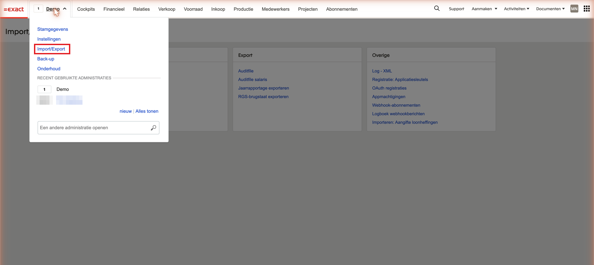
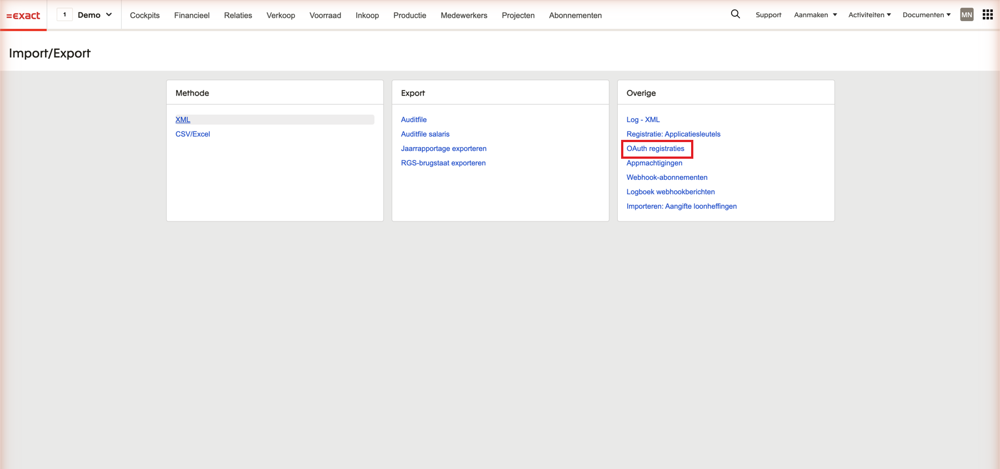
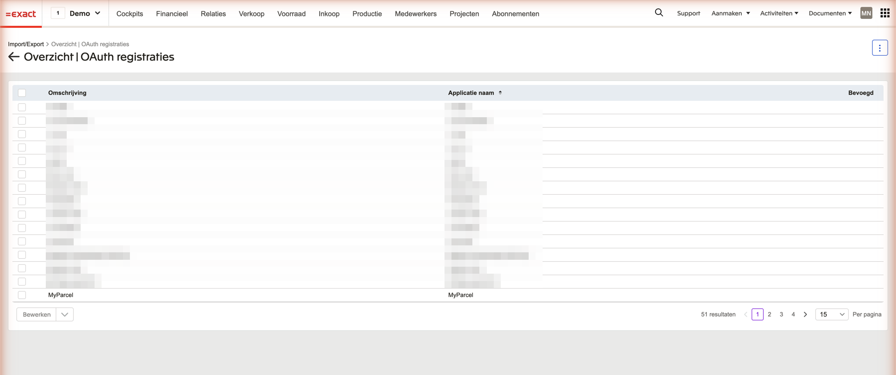
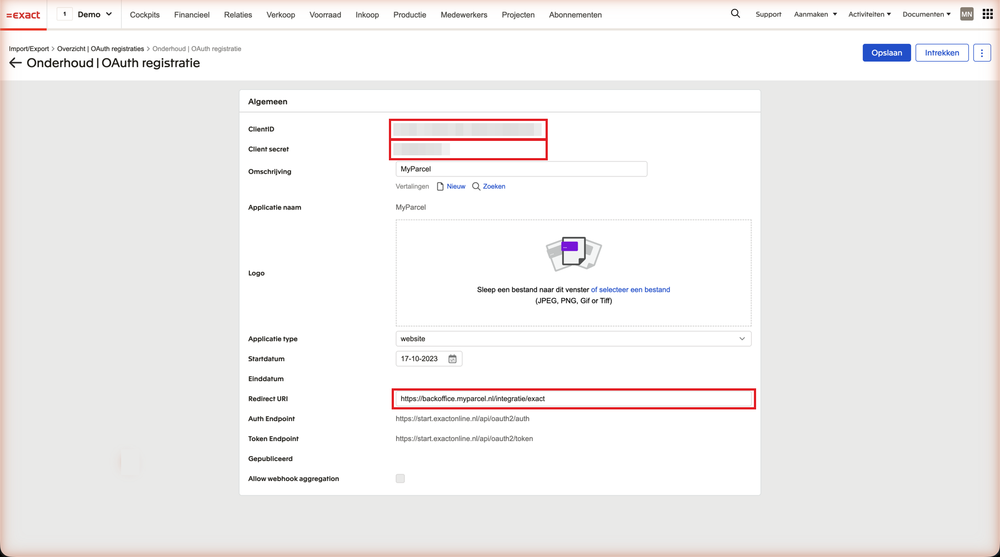

::: tip In het kort
Exact Online koppel je aan MyParcel via de pagina **Integratie** in je MyParcel-backoffice, je hoeft niets te installeren. Je registreert één keer een MyParcel-app in Exact Online en kopieert de **Client ID** en het **Client secret** naar MyParcel. Daarna importeer je je openstaande goederenleveringen uit Exact Online met één klik. Ze komen binnen als **conceptzendingen**, en je maakt de labels in je MyParcel-backoffice. MyParcel schrijft de barcode terug naar de goederenlevering in Exact Online. Voor deze koppeling heb je de Exact Online-module *Handel* nodig.
:::

## Snelstart, je eerste goederenleveringen in 10 minuten
Genoeg om Exact Online vandaag aan MyParcel te koppelen. Voor de details, zie [Wat zoek je?](#wat-zoek-je) hieronder.

1. **Account.** Heb je nog geen MyParcel-account? Maak er een aan via [myparcel.nl/register](https://www.myparcel.nl/register).
2. **App registreren.** Klik in Exact Online op je administratienaam → **Import/Export** → **OAuth registraties** → **Nieuw**. Accepteer de voorwaarden en vul de redirect URI `https://backoffice.myparcel.nl/integratie/exact` in.
3. **Sleutels kopiëren.** Sla de registratie op en kopieer de **Client ID** en het **Client secret**.
4. **Sleutels plakken.** Ga in [backoffice.myparcel.nl](https://backoffice.myparcel.nl) naar *Shopinstellingen → Integratie*, scrol naar **Externe koppelingen**, open **Exact Online**, plak beide sleutels en sla op.
5. **Goederenleveringen importeren.** Klik in het overzicht *Zendingen* op **Importeer externe orders**, selecteer je goederenleveringen en importeer ze.

::: tip Klaar als je dit ziet
- De MyParcel-app in de lijst onder **OAuth registraties** in Exact Online
- Je nieuwe goederenleveringen als conceptzendingen in het overzicht *Zendingen*
:::

## Wat zoek je?
| Wat wil je doen? | Ga naar |
| --- | --- |
| Begrijpen hoe de koppeling werkt | [1 · Hoe de koppeling werkt](#1-hoe-de-koppeling-werkt) |
| De MyParcel-app registreren in Exact Online | [2 · De app registreren in Exact Online](#2-de-app-registreren-in-exact-online) |
| Exact Online aan je MyParcel-account koppelen | [3 · MyParcel koppelen](#3-myparcel-koppelen) |
| Goederenleveringen importeren en labels printen | [4 · Dagelijks gebruik](#4-dagelijks-gebruik) |
| Weten hoe updates werken | [5 · Updates](#5-updates) |
| Er werkt iets niet | [6 · Er werkt iets niet, diagnose](#6-er-werkt-iets-niet-diagnose) |
| Antwoord op een veelgestelde vraag | [7 · FAQ](#7-faq) |

## 1 · Hoe de koppeling werkt
Exact Online is boekhoudsoftware, dus er is geen plugin om te installeren. Je registreert een app voor MyParcel in je Exact Online-administratie. Daarmee krijg je een Client ID en een Client secret. Die vul je allebei in je MyParcel-backoffice in, en MyParcel leest daarna je goederenleveringen uit Exact Online.

Je haalt je openstaande goederenleveringen zelf op en ze komen in MyParcel binnen als conceptzendingen. Je maakt de labels in je MyParcel-backoffice, en MyParcel schrijft de barcode terug naar de goederenlevering in Exact Online.

::: warning Je hebt de module Handel nodig
De koppeling werkt met goederenleveringen, en die horen bij de Exact Online-module *Handel*. Zonder die module is er voor MyParcel niets te importeren. Heb je de module niet? Vraag Exact Online ernaar.
:::

## 2 · De app registreren in Exact Online
Sinds april 2026 staan apps niet meer in de Exact App Store. Je registreert de MyParcel-app in je eigen Exact Online-administratie, onder **OAuth registraties**.

::: warning Je hebt het recht Apps beheren nodig
Alleen een gebruiker met het gebruikersrecht **Apps beheren** kan een app registreren. Zie je de stappen hieronder niet? Vraag het dan aan de beheerder van je Exact Online-account.
:::

1. Log in bij Exact Online. Klik bovenaan de pagina op je administratienaam en kies **Import/Export**.

2. Klik in de kolom **Overige** op **OAuth registraties**.

3. Je ziet het overzicht van je app-registraties. Klik op **Nieuw** om een nieuwe app voor MyParcel te registreren.

4. Vink het vakje aan om de voorwaarden te accepteren en klik op **Accepteren**.
5. Vul de registratie in:

   | Veld | Wat vul je in |
   | --- | --- |
   | **Applicatienaam** | Een unieke naam voor de MyParcel-app, bijvoorbeeld *MyParcel* gevolgd door de naam van je shop. |
   | **Redirect URI** | `https://backoffice.myparcel.nl/integratie/exact` |
   | **Omschrijving** | Een korte omschrijving, bijvoorbeeld *MyParcel*. |

6. Sla de registratie op. Bovenaan de pagina zie je nu een **ClientID** en een **Client secret**. Kopieer ze allebei, je hebt ze nodig in [§3](#3-myparcel-koppelen).

::: warning Houd het Client secret voor jezelf
De Client ID en het Client secret geven samen toegang tot je Exact Online-administratie. Plak ze alleen in je MyParcel-backoffice, nooit in een e-mail of chat.
:::

## 3 · MyParcel koppelen
1. Log in bij [backoffice.myparcel.nl](https://backoffice.myparcel.nl) en ga naar **Shopinstellingen → Integratie**.
2. Scrol naar **Externe koppelingen** en open **Exact Online** met de knop **+**.
3. Plak de **Client ID** en het **Client secret** uit [§2](#2-de-app-registreren-in-exact-online). Let op spaties voor of na de sleutels.
4. Sla op. Vraagt Exact Online je om in te loggen en MyParcel toestemming te geven? Doe dat met het account van de administratie waarin je de app hebt geregistreerd.

De koppeling is nu klaar voor gebruik.

## 4 · Dagelijks gebruik
1. Open in je MyParcel-backoffice het overzicht **Zendingen** en klik op **Importeer externe orders**.
2. Je openstaande goederenleveringen uit Exact Online staan in de lijst. Importeer ze een voor een met **Importeer**, of selecteer er meerdere en importeer ze in één keer.
3. Een geïmporteerde goederenlevering krijgt een groen vinkje. De goederenleveringen komen binnen als **conceptzendingen**. Klik op het potlood achter een zending om die te wijzigen, bijvoorbeeld het pakkettype of de bezorgopties.
4. Maak de labels en geef de pakketten mee aan de vervoerder.

Zodra de zending bij de vervoerder is aangemeld, schrijft MyParcel de barcode naar het veld **Trackingnummer** van de goederenlevering in Exact Online.

::: warning Alleen nieuwe goederenleveringen
MyParcel importeert alleen goederenleveringen die je maakt nadat je Exact Online hebt gekoppeld. Goederenleveringen van vóór de koppeling worden niet opgehaald.
:::

Je betaalt pas voor een zending als die echt aan de vervoerder is overgedragen.

## 5 · Updates
De koppeling draait in je MyParcel-backoffice, dus je hoeft niets bij te werken. Je gebruikt altijd de nieuwste versie.

## 6 · Er werkt iets niet, diagnose
Loop deze tabel van boven naar beneden door, de meeste problemen zijn binnen een paar minuten opgelost.

| Symptoom | Wat controleer je? |
| --- | --- |
| **Je ziet OAuth registraties of de knop Nieuw niet** | Je Exact Online-gebruiker heeft het recht **Apps beheren** nodig. Vraag het aan de beheerder van je Exact Online-account ([§2](#2-de-app-registreren-in-exact-online)). |
| **Exact Online weigert de koppeling** | Is de **Redirect URI** precies `https://backoffice.myparcel.nl/integratie/exact`? Kloppen de **Client ID** en het **Client secret**, zonder spaties? Kopieer ze opnieuw uit de registratie in Exact Online ([§2](#2-de-app-registreren-in-exact-online)). |
| **Er verschijnen geen goederenleveringen bij het importeren** | Alleen goederenleveringen die je na het koppelen hebt gemaakt, worden geïmporteerd ([§4](#4-dagelijks-gebruik)). Heb je de module *Handel*? ([§1](#1-hoe-de-koppeling-werkt)) |
| **Een goederenlevering toont een rode driehoek bij het importeren** | Het afleveradres is waarschijnlijk niet compleet of niet goed. Pas het adres aan in Exact Online en importeer de goederenlevering opnieuw. |
| **De barcode verschijnt niet in Exact Online** | De barcode gaat terug zodra de zending bij de vervoerder is aangemeld. Kijk in het veld **Trackingnummer** van de goederenlevering. |

## 7 · FAQ

### Moet ik iets installeren?
Nee. Exact Online koppel je vanuit je MyParcel-backoffice, er is geen plugin of app om te installeren. Je registreert alleen een app in Exact Online ([§2](#2-de-app-registreren-in-exact-online)).

### Welke Exact Online-module heb ik nodig?
De module *Handel*. De koppeling importeert goederenleveringen, en die horen bij die module.

### Staat MyParcel nog in de Exact App Store?
Nee. Sinds april 2026 registreer je de app zelf in Exact Online, onder *Import/Export → OAuth registraties* ([§2](#2-de-app-registreren-in-exact-online)).

### Worden goederenleveringen automatisch geïmporteerd?
Nee. Je haalt je openstaande goederenleveringen zelf op met **Importeer externe orders** in het overzicht *Zendingen*.

### Gaat de barcode terug naar Exact Online?
Ja. Zodra de zending bij de vervoerder is aangemeld, schrijft MyParcel de barcode naar het veld **Trackingnummer** van de goederenlevering.

## Bronnen & support
- [backoffice.myparcel.nl ↗](https://backoffice.myparcel.nl), integratie, zendingen, account en facturatie.
- [Exact Online ↗](https://www.exact.com/nl/).
- [Contact MyParcel support](../../contact.md), **023 - 30 30 315** · [info@myparcel.nl](mailto:info@myparcel.nl).

Deze handleiding beschrijft de Exact Online-koppeling in de MyParcel-backoffice zoals die werkt in november 2026.
