::: tip In het kort
De extensie **MyParcel NL** koppelt je OpenCart 3-shop aan MyParcel. Je exporteert orders en print PostNL-labels direct vanuit de orderlijst van OpenCart, je klanten kunnen in de checkout een bezorgmoment of een PostNL-afhaalpunt kiezen, en de Track & Trace-code kan in de orderbevestiging mee. De extensie bestaat uit drie delen: een **Module** met alle instellingen, een **Verzendmethode** voor de checkout en een **Order Total** dat de meerprijs van bezorgopties bij de order optelt.
:::

::: warning Oudere extensie
Deze handleiding beschrijft versie **1.1.17**, gebouwd voor OpenCart 3.0.x en getest op OpenCart 3.0.2.0 met PHP tot en met 8.2. De extensie ondersteunt **alleen PostNL**. MyParcel ontwikkelt verder aan de [OpenCart 4-extensie](./opencart.md), dus zet je een nieuwe shop op, begin dan met OpenCart 4.
:::

## Snelstart, je eerste label in 20 minuten
Genoeg om vandaag je eerste order te verzenden. Voor de details, zie [Wat zoek je?](#wat-zoek-je) hieronder.

1. **Account.** Heb je nog geen MyParcel-account? Maak er een aan via [myparcel.nl/register](https://www.myparcel.nl/register).
2. **API-key kopiëren.** Log in op [backoffice.myparcel.nl](https://backoffice.myparcel.nl) → *Shopinstellingen → Integratie* → kopieer de API-key.
3. **Extensie installeren.** Download de `.ocmod.zip` bij de [laatste release](https://github.com/myparcelnl/opencart3/releases/latest), upload hem onder **Extensions → Installer** en klik op **Refresh** onder **Extensions → Modifications**.
4. **De drie delen aanzetten.** Installeer onder **Extensions → Extensions** de onderdelen **Myparcel NL** (type *Modules*), **MyParcel Shipping** (type *Shipping*) en **MyParcel Total** (type *Order Total*).
5. **Key plakken.** Open **System → MyParcel**, plak de key in **API** op het tabblad **General** en sla op.
6. **Label printen.** Klik in **Sales → Orders** naast een order op **Export to MyParcel** en daarna op **Print MyParcel label**.

::: tip Klaar als je dit ziet
- De label-PDF downloadt of opent in een nieuw tabblad
- De order toont een Track & Trace-code en een status zoals *pending - registered*
- De zending staat in je MyParcel-backoffice
:::

## Wat zoek je?
| Wat wil je doen? | Ga naar |
| --- | --- |
| De drie delen begrijpen | [1 · Hoe de extensie werkt](#1-hoe-de-extensie-werkt) |
| De extensie installeren | [2 · Installeren](#2-installeren) |
| De API-key en algemene instellingen invullen | [3 · Instellingen · General](#3-instellingen-general) |
| Pakkettypes en standaardopties kiezen | [4 · Instellingen · Default export settings](#4-instellingen-default-export-settings) |
| Bezorgmomenten en afhaalpunten aanbieden | [5 · Instellingen · Checkout](#5-instellingen-checkout) |
| HS-codes voor de douane instellen | [6 · Productinstellingen](#6-productinstellingen) |
| Zien wat je klanten zien | [7 · De checkout voor je klant](#7-de-checkout-voor-je-klant) |
| Orders exporteren en labels printen | [8 · Dagelijks gebruik](#8-dagelijks-gebruik) |
| Er werkt iets niet | [9 · Er werkt iets niet, diagnose](#9-er-werkt-iets-niet-diagnose) |
| Antwoord op een veelgestelde vraag | [10 · FAQ](#10-faq) |

## 1 · Hoe de extensie werkt
De extensie bestaat uit drie delen. Voor alle functies heb je ze alle drie nodig.

| Onderdeel | Waar | Wat het doet |
| --- | --- | --- |
| **Myparcel NL** | *Extensions → Extensions → Modules* | Alle instellingen, en de MyParcel-acties in je orderlijst. Ook te vinden onder **System → MyParcel**. |
| **MyParcel Shipping** | *Extensions → Extensions → Shipping* | De verzendmethode die je klant in de checkout kiest. De MyParcel-bezorgopties staan daarbinnen. |
| **MyParcel Total** | *Extensions → Extensions → Order Total* | Telt de meerprijs van een gekozen bezorgoptie, zoals avondlevering, op bij het ordertotaal. |

Vanuit de orderlijst stuur je een order naar MyParcel (*exporteren*) en de extensie downloadt het PostNL-label. De Track & Trace-code wordt bij de order bewaard en kan in de e-mail aan je klant mee.

## 2 · Installeren
1. **Maak een back-up** van je shop, of probeer de extensie eerst op een kopie.
2. Download `myparcel_opencart_3.0.2.0_v1.1.17.ocmod.zip` bij de [MyParcel OpenCart 3-releases](https://github.com/myparcelnl/opencart3/releases/latest).
3. Ga naar **Extensions → Installer**, klik op **Upload** en kies het zipbestand.
4. Ga naar **Extensions → Modifications** en klik op **Refresh** (de blauwe knop rechtsboven). Zonder deze stap werkt de extensie niet.
5. Ga naar **Extensions → Extensions** en installeer de drie delen met de groene **+**-knop:
   - kies *Modules* en installeer **Myparcel NL**;
   - kies *Shipping* en installeer **MyParcel Shipping**;
   - kies *Order Total* en installeer **MyParcel Total**.

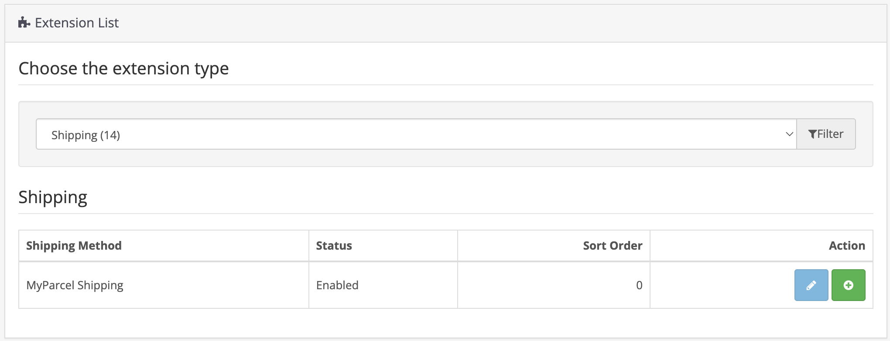

Klik daarna op het potloodje naast **MyParcel Shipping** en controleer de instellingen:

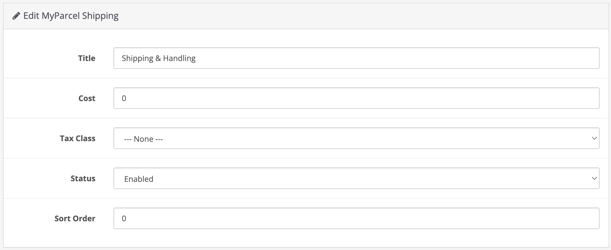

| Instelling | Wat het doet |
| --- | --- |
| **Title** | De naam van de verzendmethode in de checkout. |
| **Cost** | De basisverzendkosten. De meerprijs van bezorgopties komt daar bovenop. |
| **Tax Class** | De belastingklasse voor de verzendkosten. |
| **Status** | Zet op **Enabled** om de methode in de checkout te tonen. |
| **Sort Order** | De plek tussen je andere verzendmethoden. |

Controleer tot slot of **MyParcel Total** aan staat onder *Order Total*. De sorteervolgorde bepaalt waar de meerprijs in de totalen verschijnt.

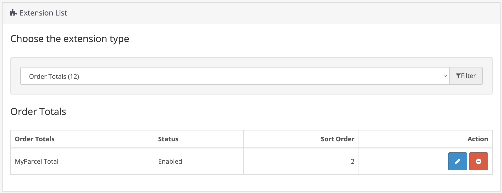

::: warning Shipping is niet de instellingenpagina
Het potloodje naast **MyParcel Shipping** toont alleen de velden hierboven. Alle andere instellingen zitten in de module: **System → MyParcel**, of het potloodje naast **Myparcel NL** onder *Modules*.
:::

## 3 · Instellingen · General
Open **System → MyParcel**. De instellingenpagina heeft drie tabbladen: **General**, **Default Export Settings** en **Checkout**. Klik na elke wijziging op de blauwe opslaanknop rechtsboven.

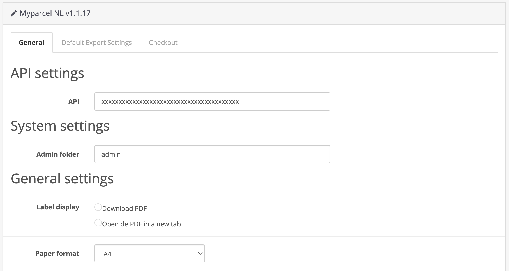

| Instelling | Wat het doet | Aanbevolen |
| --- | --- | --- |
| **API** | Je MyParcel API-key, uit [backoffice.myparcel.nl](https://backoffice.myparcel.nl) onder *Shopinstellingen → Integratie*. | Plakken zonder spaties. |
| **Admin folder** | De naam van je OpenCart-adminmap. Alleen wijzigen als je die map hebt hernoemd. | `admin` |
| **Label display** | **Download PDF** slaat het label op, **Open de PDF in a new tab** opent het in je browser. | Naar voorkeur. |
| **Paper format** | **A4** voor een gewone printer, **A6** voor een labelprinter. Bij A4 kies je bij het printen de plek op het vel. | A6 bij een labelprinter. |

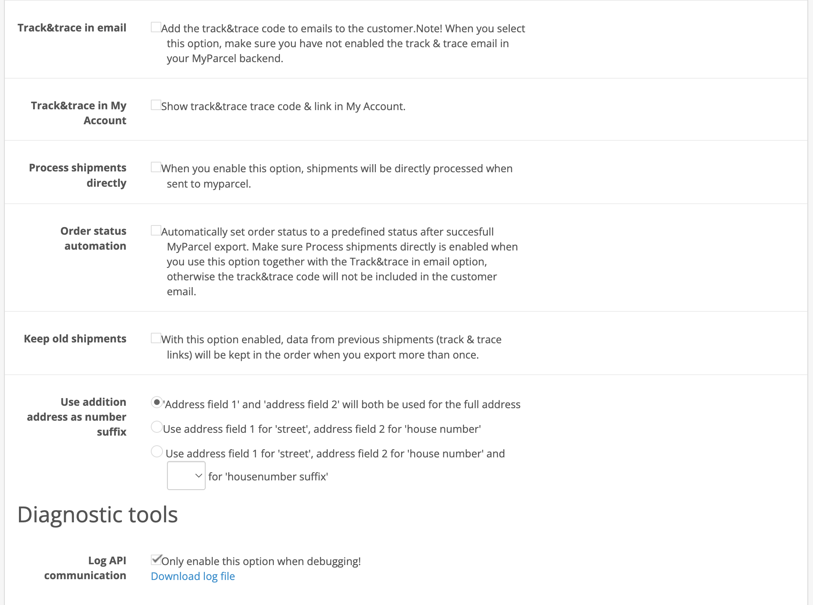

| Instelling | Wat het doet | Wanneer aanzetten |
| --- | --- | --- |
| **Track&trace in email** | Zet de Track & Trace-code in de ordermail aan je klant. | Als je wilt dat OpenCart de code verstuurt. Zet dan de Track & Trace-mail in je MyParcel-backoffice uit, anders krijgt je klant twee mails. |
| **Track&trace in My Account** | Toont de code en een link bij de order in het account van je klant. | Aanbevolen. |
| **Process shipments directly** | Meldt de zending direct aan bij PostNL zodra je hem exporteert, zodat het label en de Track & Trace-code meteen klaar zijn. Uit, dan blijft de zending als concept in je MyParcel-backoffice staan. | Als je labels direct vanuit OpenCart print. |
| **Order status automation** | Zet de order na een geslaagde export op een status naar keuze. | Gebruik je dit samen met *Track&trace in email*, zet dan ook *Process shipments directly* aan, anders gaat de mail zonder code de deur uit. |
| **Keep old shipments** | Bewaart de Track & Trace-links van eerdere zendingen bij de order als je hem opnieuw exporteert. | Als je een order soms in meerdere delen verstuurt. |
| **Use addition address as number suffix** | Hoe straat, huisnummer en toevoeging uit de adresvelden worden gelezen: beide velden als volledig adres, veld 1 als straat en veld 2 als huisnummer, of een derde veld voor de toevoeging. | Stem het af op hoe je checkout om het adres vraagt. |
| **Log API communication** | Schrijft het verkeer met MyParcel naar een logbestand, dat je downloadt met **Download log file**. | Alleen tijdens het oplossen van een probleem. |

## 4 · Instellingen · Default export settings
Deze instellingen zijn de standaard voor elke zending die je exporteert. Per order pas je ze aan voordat je exporteert, zie [§8](#8-dagelijks-gebruik).

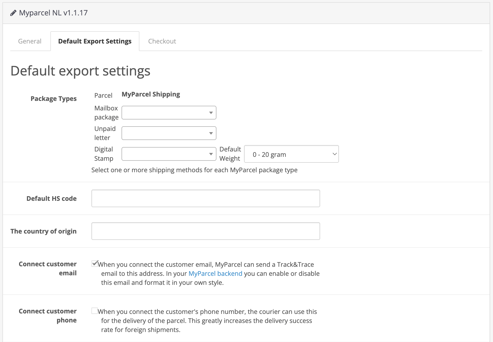

### Pakkettypes
Onder **Package Types** koppel je je OpenCart-verzendmethoden aan een MyParcel-pakkettype. Orders met **MyParcel Shipping** zijn altijd een **Parcel** (pakket). Voor elk ander type kies je een of meer verzendmethoden, bijvoorbeeld *Flat Rate*:

| Pakkettype | Wanneer gebruiken |
| --- | --- |
| **Mailbox package** (Brievenbuspakje) | Kleine, platte artikelen die door de brievenbus passen. |
| **Unpaid letter** (Ongefrankeerd label) | Een label zonder porto. |
| **Digital Stamp** (Digitale postzegel) | Brieven met een digitale postzegel. Kies de gewichtsklasse onder **Default Weight**. |

### Douane en contactgegevens
- **Default HS code** en **The country of origin**. Gebruikt voor zendingen buiten de EU als een product zelf geen waarden heeft, zie [§6](#6-productinstellingen).
- **Connect customer email**. Stuurt het e-mailadres van je klant mee met de zending, zodat MyParcel de Track & Trace-mail kan sturen. Die mail zet je aan of uit in je MyParcel-backoffice.
- **Connect customer phone**. Stuurt het telefoonnummer mee, zodat de vervoerder je klant kan bereiken. Dat helpt veel bij zendingen naar het buitenland.

### Zendingopties
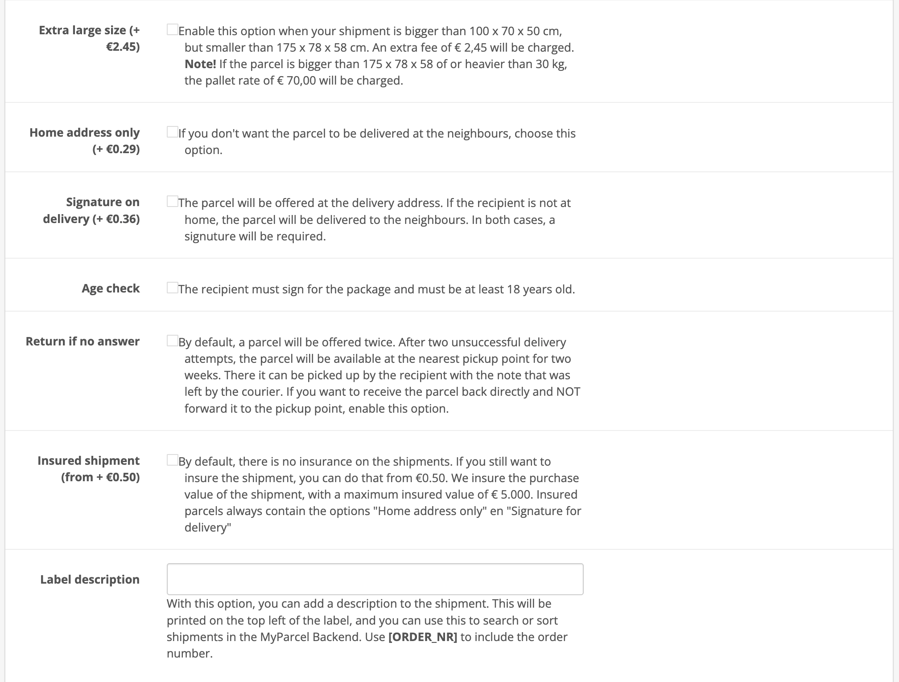

Elke optie wordt aan elk pakket toegevoegd dat je exporteert. Opties kunnen extra kosten, kijk in je MyParcel-tarieven. De prijzen die de extensie naast de labels toont, komen uit een oudere tariefkaart.

| Instelling | Wat het doet |
| --- | --- |
| **Extra large size** (Extra groot formaat) | Voor pakketten die groter zijn dan het standaardformaat. |
| **Home address only** (Alleen huisadres) | Het pakket wordt alleen op het adres van de ontvanger bezorgd, nooit bij de buren. |
| **Signature on delivery** (Handtekening voor ontvangst) | De ontvanger tekent voor het pakket. |
| **Age check** (Leeftijdscheck) | De bezorger controleert of de ontvanger 18 jaar of ouder is. |
| **Return if no answer** (Retour bij geen gehoor) | Is er niemand thuis, dan komt het pakket naar jou terug in plaats van naar een afhaalpunt. |
| **Insured shipment** (Verzekerd verzenden) | Verzekert de aankoopwaarde. Een verzekerd pakket heeft altijd ook alleen huisadres en handtekening voor ontvangst. |
| **Label description** (Labelomschrijving) | Tekst linksboven op het label. Gebruik `[ORDER_NR]` om het ordernummer te printen, zodat je erop kunt zoeken in je MyParcel-backoffice. |

## 5 · Instellingen · Checkout
Het tabblad **Checkout** bepaalt welke PostNL-bezorgopties je klanten kunnen kiezen. Vink **Enable MyParcel delivery options** aan om alle instellingen te zien.

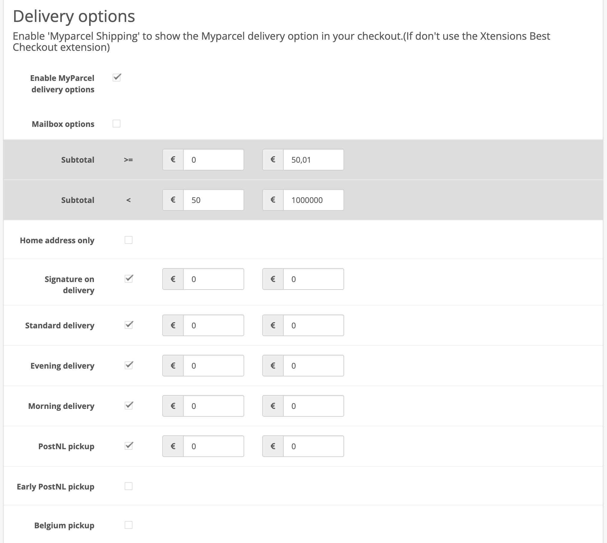

### Bezorgopties en meerprijzen
Vink elke optie aan die je wilt aanbieden. Een aangevinkte optie krijgt twee prijsvelden, één per **Subtotal**-kolom. De twee *Subtotal*-rijen bepalen het orderbedrag waarvoor elke kolom geldt. Zo kun je bijvoorbeeld avondlevering bij kleine orders laten betalen en vanaf € 50 gratis aanbieden.

| Optie | Wat je klant krijgt |
| --- | --- |
| **Standard delivery** (Standaard bezorging) | Bezorging overdag. |
| **Morning delivery** (Ochtendlevering) | Bezorging in de ochtend. |
| **Evening delivery** (Avondlevering) | Bezorging in de avond. |
| **Signature on delivery** (Handtekening voor ontvangst) | Je klant kan om een handtekening bij bezorging vragen. |
| **Home address only** (Alleen huisadres) | Je klant kan kiezen voor bezorging alleen op het huisadres. |
| **PostNL pickup** (Afhalen bij PostNL) | Afhalen bij een PostNL-punt in de buurt. |
| **Early PostNL pickup** (Vroeg afhalen bij PostNL) | Afhalen bij een PostNL-punt vanaf de vroege ochtend. |
| **Belgium pickup** (Afhalen in België) | Bezorgopties voor klanten in België, met een tarief voor standaardbezorging en een voor afhalen. |

Met **Mailbox options** kan je klant in de checkout een brievenbuspakje kiezen. Je stelt een titel, een prijs en het maximale gewicht in.

### Verwerkingsinstellingen
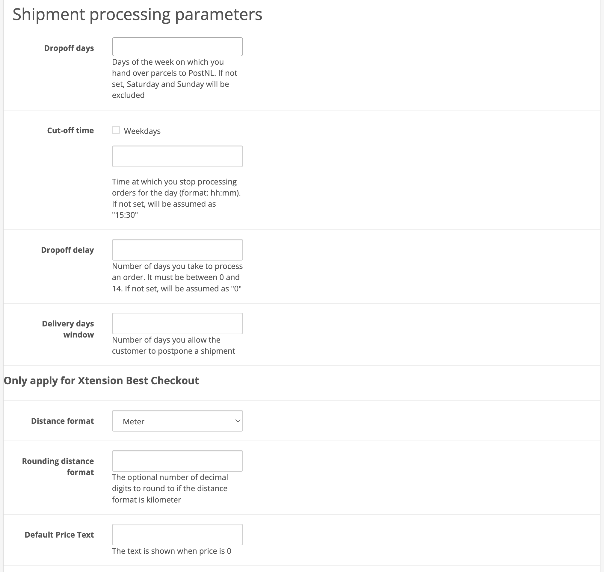

| Instelling | Wat het doet |
| --- | --- |
| **Dropoff days** (Inleverdagen) | De dagen waarop je pakketten aan PostNL geeft. Leeg betekent maandag tot en met vrijdag. |
| **Cut-off time** (Uiterste besteltijd) | Het tijdstip waarop je stopt met orders verwerken voor die dag, als `uu:mm`. Leeg betekent 15:30. Vink **Weekdays** aan om per dag een andere tijd in te stellen. |
| **Dropoff delay** (Verwerkingstijd) | Het aantal dagen, 0 tot en met 14, dat je nodig hebt voordat een order naar PostNL gaat. |
| **Delivery days window** (Bezorgdagenvenster) | Het aantal dagen dat je klant de bezorging kan uitstellen. **Verplicht** zodra bezorgopties aan staan, anders lukt opslaan niet. |

De instellingen onder **Only apply for Xtension Best Checkout** (afstandsformaat, afronding, de tekst bij een prijs van 0 en het tijdformaat) worden alleen gebruikt met de extensie Xtensions Best Checkout.

### Opmaak
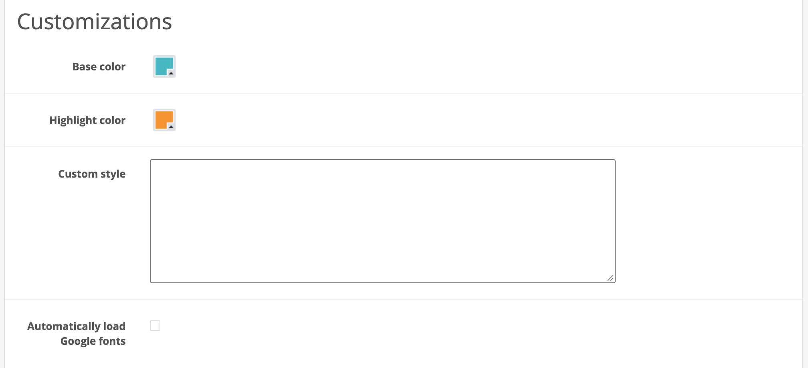

**Base color** en **Highlight color** bepalen de kleuren van de bezorgopties, in **Custom style** zet je je eigen CSS, en **Automatically load Google fonts** laadt de lettertypes die de bezorgopties gebruiken.

## 6 · Productinstellingen
De extensie voegt aan elk product een tabblad **My parcel** toe, met twee velden voor zendingen buiten de EU.

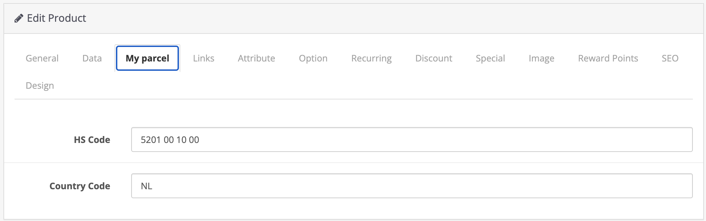

- **HS Code**. De douanecode van het product.
- **Country Code**. Het land van herkomst, bijvoorbeeld `NL`.

Lege velden vallen terug op de standaardwaarden uit [§4](#douane-en-contactgegevens).

## 7 · De checkout voor je klant
Staan de bezorgopties aan, dan ziet je klant de PostNL-opties onder *Delivery Method* in de checkout, binnen **MyParcel Shipping**. De opties worden in het Nederlands getoond.

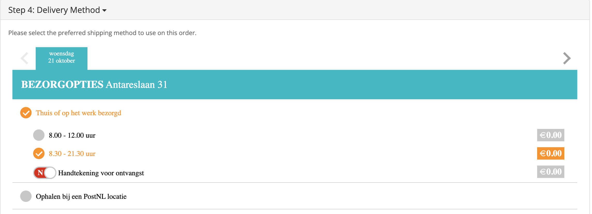

Onder *Thuis of op het werk bezorgd* kiest je klant een bezorgdag en een tijdvak, en de extra opties die je hebt aangezet, zoals handtekening voor ontvangst.

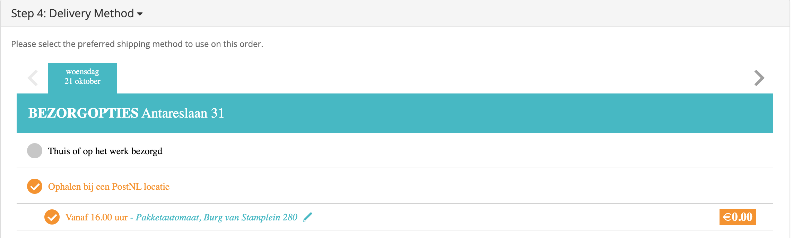

Onder *Ophalen bij een PostNL locatie* kiest je klant een afhaalpunt. Het potloodje opent de lijst met punten in de buurt.

De keuze wordt bij de order bewaard en overgenomen als je hem exporteert.

## 8 · Dagelijks gebruik
De extensie voegt MyParcel-acties toe aan **Sales → Orders**.

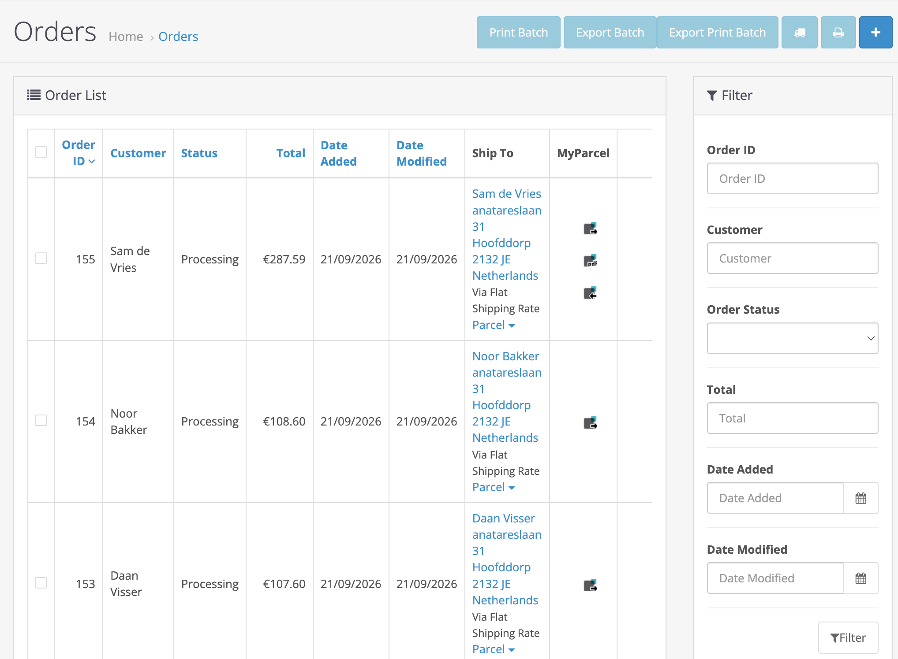

### Eén order
1. Klik in de kolom **Ship To** op het pakkettype, bijvoorbeeld **Parcel**, om de zending te controleren of aan te passen.
2. Klik in de kolom **MyParcel** op **Export to MyParcel**.
3. Klik op **Print MyParcel label** om het label te downloaden of te openen.

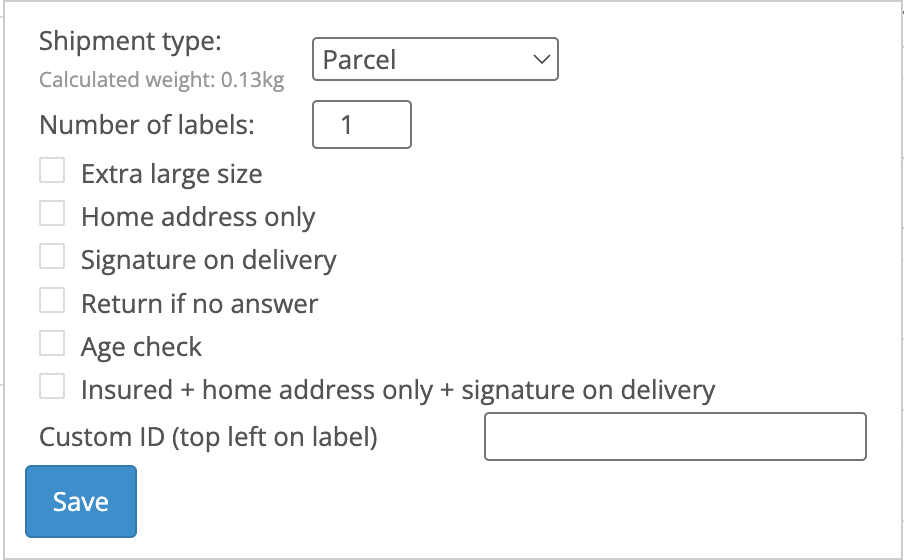

In het zendingvenster wijzig je voor deze order het **Shipment type**, het **Number of labels** (meerdere pakketten voor één order), de zendingopties en een **Custom ID** dat linksboven op het label komt. Klik op **Save**.

### Meerdere orders tegelijk
Vink de orders aan en gebruik de knoppen bovenaan de orderlijst:

- **Export Batch** stuurt de geselecteerde orders naar MyParcel.
- **Print Batch** print de labels van orders die al geëxporteerd zijn.
- **Export Print Batch** doet beide in één keer.

### Retourlabels
Het icoon **Email return label** stuurt je klant een mail met een link om een retourlabel te printen.

### Op de order zelf
De orderpagina toont dezelfde MyParcel-acties, de Track & Trace-code met de status van de zending, en het verzendadres met het gekozen pakkettype.

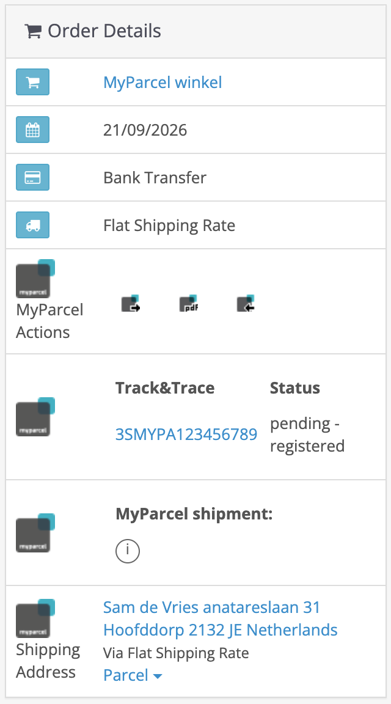

Je betaalt pas voor een zending als die echt aan PostNL is overgedragen.

## 9 · Er werkt iets niet, diagnose
Loop deze tabel van boven naar beneden door, de meeste problemen zijn binnen een paar minuten opgelost.

| Symptoom | Wat je controleert |
| --- | --- |
| **De module verschijnt niet onder Modules** | Heb je op **Refresh** geklikt onder *Extensions → Modifications* ([§2](#2-installeren))? Controleer je PHP-versie: de extensie is getest tot en met PHP 8.2. |
| **Ik zie alleen Title en Cost** | Je hebt de verzendmethode geopend. De instellingen staan onder **System → MyParcel** ([§2](#2-installeren)). |
| **Opslaan mislukt met "Delivery day windows cannot be empty"** | Vul **Delivery days window** in op het tabblad *Checkout* ([§5](#verwerkingsinstellingen)). |
| **Geen bezorgopties in de checkout** | Is **Enable MyParcel delivery options** aangevinkt en staat er minstens één optie aan ([§5](#5-instellingen-checkout))? Zijn **MyParcel Shipping** en **MyParcel Total** geïnstalleerd en ingeschakeld ([§2](#2-installeren))? Heeft je klant een Nederlands of Belgisch adres ingevuld? |
| **De meerprijs ontbreekt in het totaal** | Is **MyParcel Total** geïnstalleerd en ingeschakeld onder *Order Total*? |
| **Exporteren mislukt of geeft een fout** | Klopt de **API**-key, zonder spaties ([§3](#3-instellingen-general))? Zet **Log API communication** aan, probeer het opnieuw en download het logbestand voor MyParcel support. |
| **Het huisnummer komt in het verkeerde veld** | Stem **Use addition address as number suffix** af op je checkout ([§3](#3-instellingen-general)). |
| **Mijn klant krijgt twee Track & Trace-mails** | Zet **Track&trace in email** in OpenCart uit, of de Track & Trace-mail in je MyParcel-backoffice. |
| **Export Print Batch toont de labels niet** | Gebruik eerst **Export Batch** en daarna **Print Batch**. |

## 10 · FAQ

### Moet ik deze extensie nog gebruiken?
Hij werkt voor shops die op OpenCart 3 blijven. MyParcel ontwikkelt verder aan de [OpenCart 4-extensie](./opencart.md), die ook meer vervoerders ondersteunt.

### Welke vervoerders kan ik gebruiken?
Alleen PostNL.

### Waar vind ik mijn API-key?
In [backoffice.myparcel.nl](https://backoffice.myparcel.nl) onder *Shopinstellingen → Integratie*.

### Kan ik meerdere pakketten voor één order versturen?
Ja. Stel het **Number of labels** in het zendingvenster in voordat je exporteert ([§8](#en-order)).

### Werkt de extensie met mijn one-page checkout of Journal-thema?
De extensie ondersteunt de standaard checkout van OpenCart en een aantal andere, zoals Journal en Xtensions Best Checkout. Test de checkout op een kopie van je shop voordat je live gaat.

### Wanneer betaal ik?
MyParcel factureert een zending pas als die echt aan PostNL is overgedragen.

## Bronnen & support
- [backoffice.myparcel.nl ↗](https://backoffice.myparcel.nl), account, API-key, vervoerders en facturatie.
- [MyParcel OpenCart 3-releases ↗](https://github.com/myparcelnl/opencart3/releases), de extensie downloaden.
- [Contact MyParcel support](../../contact.md), **023 - 30 30 315** · [info@myparcel.nl](mailto:info@myparcel.nl).

Deze handleiding beschrijft de extensie MyParcel NL 1.1.17 voor OpenCart 3 zoals hij werkt in oktober 2026.
