::: tip In short
CCV Shop connects to MyParcel through apps in the **CCV Shop App Store**. **MyParcel Verzendservice** registers your orders with MyParcel and prints the labels straight from your CCV Shop order management, and the Track & Trace code is added to the order for you. Add **MyParcel Bezorgopties** on top to show delivery days, time slots and pickup points at checkout. CCV Shop builds and maintains these apps, so questions about the apps themselves go to CCV Shop support.
:::

## Quickstart, your first label in 15 minutes
Enough to ship your first order today. For the details, see [Looking for…](#looking-for) below.

1. **Account.** Don't have a MyParcel account yet? Create one at [myparcel.nl/register](https://www.myparcel.nl/register).
2. **Copy the API key.** Log in to [backoffice.myparcel.nl](https://backoffice.myparcel.nl) → *Shop settings → Integration* → copy the API key.
3. **Install the app.** In your CCV Shop back office go to **App Store**, open **MyParcel Verzendservice** and install it. Shipping from Belgium? Install **MyParcel België Verzendservice** instead.
4. **Paste the key.** Go to *Startpunt → Mijn webshop → Instellingen → Verzendkosten & logistiek → MyParcel verzendservice*, paste the key in **MyParcel API key**, choose your default **Soort zending** (Package type) and click **Opslaan** (Save).
5. **Print a label.** Open an order, go to the **Koppelingen** (Integrations) tab and click **Meld de order aan bij MyParcel en download etiket** (Register the order with MyParcel and download label).

::: tip You're done when you see this
- The label downloads as soon as you register the order
- The order has a Track & Trace code under *Verzending* (Shipping) on the *Orderoverzicht* (Order overview) tab
- The *Historie* (History) table on the *Koppelingen* tab shows the action without an error
:::

## Looking for…
| What do you want to do? | Go to |
| --- | --- |
| Understand which app does what | [1 · How the connection works](#1-how-the-connection-works) |
| Install the apps | [2 · Installing the apps](#2-installing-the-apps) |
| Connect your account | [3 · Connecting your MyParcel account](#3-connecting-your-myparcel-account) |
| Set the default package type, options and insurance | [4 · Default shipment settings](#4-default-shipment-settings) |
| Offer delivery days, time slots and pickup points | [5 · Delivery options at checkout](#5-delivery-options-at-checkout) |
| Check what your customers see | [7 · The checkout experience](#7-the-checkout-experience) |
| Print labels for one order or many | [8 · Daily use](#8-daily-use) |
| Something's not working | [9 · Something's not working, diagnostics](#9-somethings-not-working-diagnostics) |
| Answer to a frequently asked question | [10 · FAQ](#10-faq) |

## 1 · How the connection works
CCV Shop offers three MyParcel apps in its App Store, all in the *Verzendingen* (Shipping) category:

| App | What it does |
| --- | --- |
| **MyParcel Verzendservice** | Registers orders with MyParcel NL and downloads the labels inside your CCV Shop order management. |
| **MyParcel België Verzendservice** | The same, for a MyParcel BE account. |
| **MyParcel Bezorgopties** | An extension that shows delivery days, time slots and pickup points at checkout. It needs one of the two apps above. |

You don't need to log in to MyParcel to create a label: you register the order from CCV Shop, the label downloads straight away and the Track & Trace code is written to the order, so you can send it to your customer with a status update.

::: warning Built by CCV Shop
CCV Shop develops and supports these apps. For questions about the apps or your CCV Shop back office, contact CCV Shop support. For your MyParcel account, contracts and carriers, contact MyParcel.
:::

## 2 · Installing the apps
1. In your CCV Shop back office, open **App Store** in the left-hand menu.
2. Search for *MyParcel* or open the **Verzendingen** category.
3. Install **MyParcel Verzendservice**, or **MyParcel België Verzendservice** for a MyParcel BE account.
4. Want delivery options at checkout? Also install **MyParcel Bezorgopties**. It only installs once one of the two shipping apps is in place.

Your installed apps are listed under **App Store → Geïnstalleerde CCV Shop apps** (Installed CCV Shop apps).

## 3 · Connecting your MyParcel account
All settings of both apps live on one page: *Startpunt → Mijn webshop → Instellingen → Verzendkosten & logistiek → MyParcel verzendservice*. With the Belgian app, the page is called *MyParcel België verzendservice*.

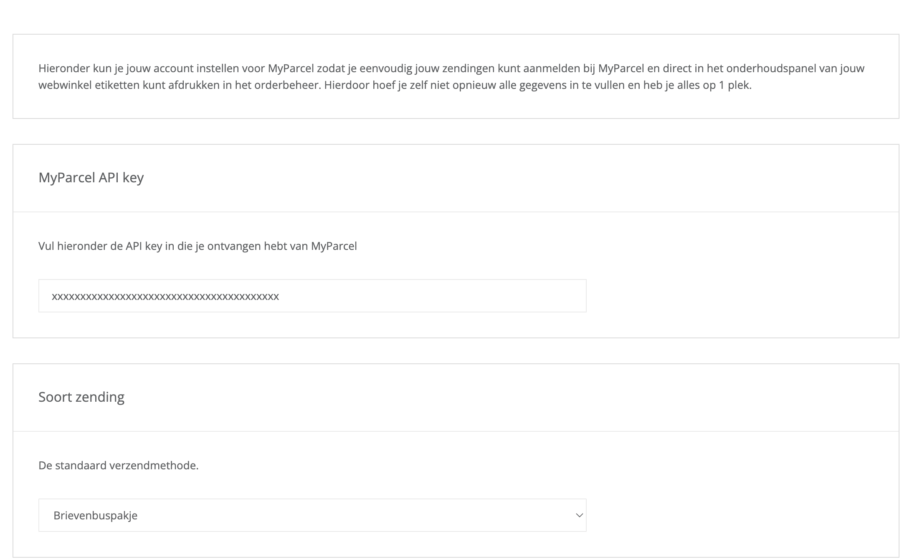

1. Copy your API key from [backoffice.myparcel.nl](https://backoffice.myparcel.nl) under *Shop settings → Integration*.
2. Paste it in **MyParcel API key**. Watch out for spaces before or after the key.
3. Click **Opslaan** (Save) at the bottom right. **Toepassen** (Apply) also saves.

::: warning One key, one shop
The key links this CCV Shop to one shop in your MyParcel account. All labels and invoices end up in that shop.
:::

## 4 · Default shipment settings
These settings are the defaults for every order you register. You can change them per order on the *Koppelingen* tab before you register it, see [§8](#8-daily-use).

### Package type and extra options
**Soort zending** (Package type) is the package type every new shipment starts with.

| Option | When to use it |
| --- | --- |
| **Pakket** (Package) | The standard choice for most orders. |
| **Pakket extra groot** (Extra large package) | Parcels larger than the standard package size. |
| **Klein pakket** (Small package) | Small parcels, see your MyParcel rates for the size limits. |
| **Brievenbuspakje** (Mailbox package) | Small, flat items that fit through a letterbox. |
| **Ongefrankeerd label** (Unstamped label) | A label without postage. |

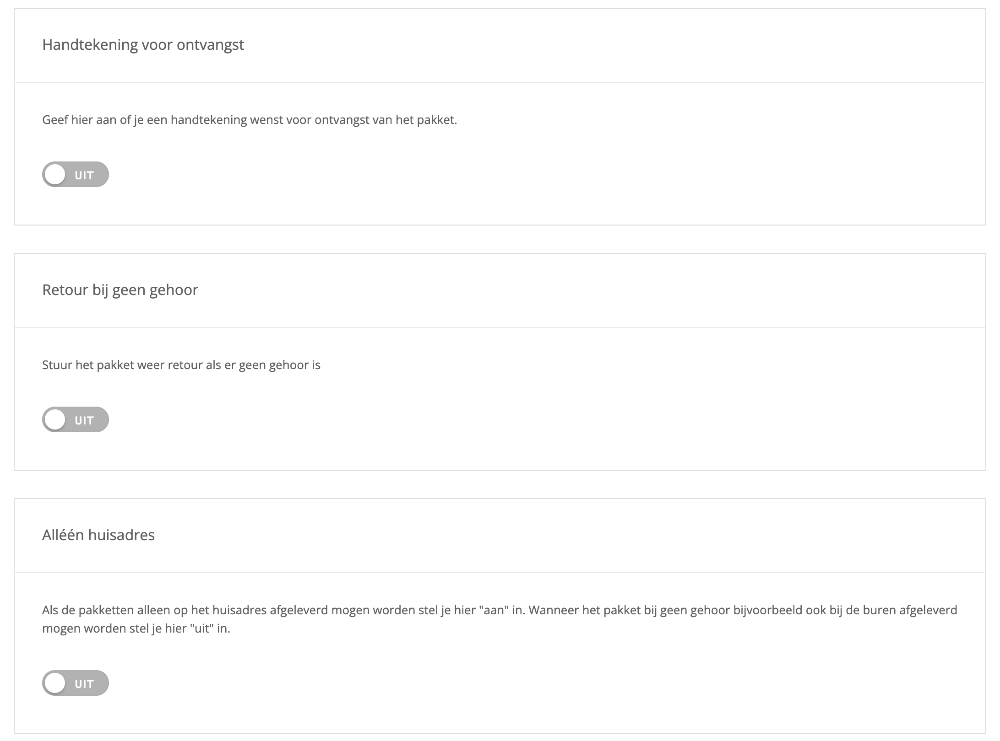

Each switch below adds an option to every package. Options can cost extra, check your MyParcel rates.

| Setting | What it does | When to switch it on |
| --- | --- | --- |
| **Handtekening voor ontvangst** (Signature on delivery) | The recipient signs for the parcel. | Valuable orders, or when you need proof of delivery. |
| **Retour bij geen gehoor** (Return when not home) | If nobody is home, the parcel comes back to you instead of going to a pickup point. | Orders that must not end up anywhere but with the recipient. |
| **Alléén huisadres** (Home address only) | The parcel is only delivered at the recipient's address, never with the neighbours. Switch it off if a neighbour may accept the parcel. | Orders that must be handed over at the address itself. |

These options apply to packages. For a mailbox package or an unstamped label they are hidden on the order screen.

### Insurance and label format
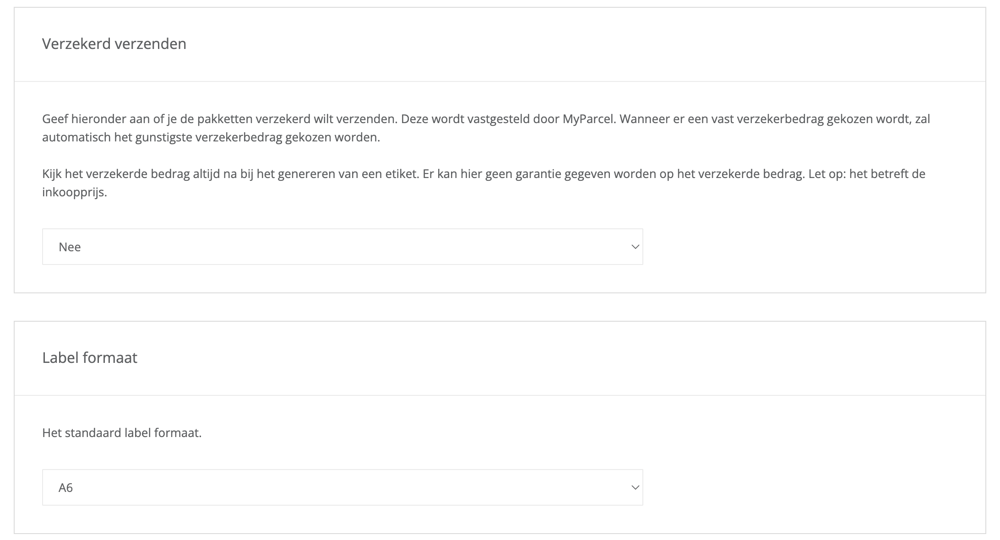

- **Verzekerd verzenden** (Insured shipping). Choose **Nee** (No), a fixed amount from *Verzekerd tot 100 euro* up to *Verzekerd tot 5.000 euro*, or **Gehele order bedrag** (Full order amount). With a fixed amount, the most favourable insured amount is picked for you. The amount concerns the purchase price of the goods.
- **Label formaat** (Label format). **A6** for a label printer, **A4** for a regular printer. With A4 you choose per order where on the sheet the label prints.

::: warning Check the insured amount
The app cannot guarantee the insured amount. Check it on every label you create, especially when you insure the full order amount.
:::

### Age check
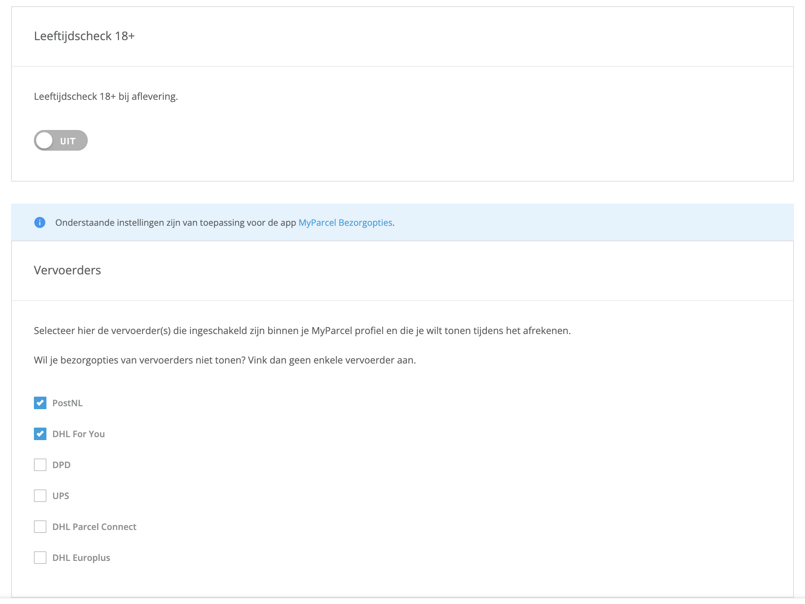

**Leeftijdscheck 18+** (Age check 18+) makes the carrier check the recipient's age on delivery. Switch it on if you sell alcohol, tobacco or other age-restricted goods. An age check cannot be combined with morning or evening delivery, and it always comes with signature on delivery and home address only.

## 5 · Delivery options at checkout
The settings below the blue info bar belong to the **MyParcel Bezorgopties** app. They decide what your customers can choose at checkout. Without that app, these settings have no effect.

### Carriers
Under **Vervoerders** (Carriers), tick the carriers whose delivery options you want to show: **PostNL**, **DHL For You**, **DPD**, **UPS**, **DHL Parcel Connect** and **DHL Europlus**. Only tick carriers that are active on your MyParcel account. Don't want to show any delivery options? Leave all carriers unticked.

UPS is supported with UPS Standard, not with UPS Express Saver. DHL Europlus does not offer pickup points.

### Processing time and cut-off time
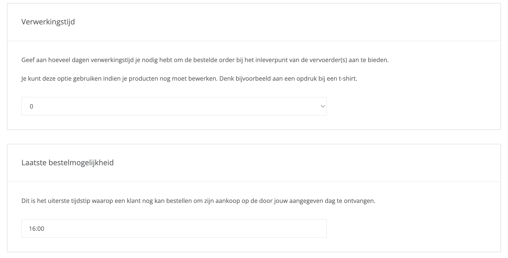

- **Verwerkingstijd** (Processing time). The number of days, 0 to 14, you need before an order is handed to the carrier. Use it when you still have to work on products, for example printing a t-shirt.
- **Laatste bestelmogelijkheid** (Last moment to order). The latest time a customer can order to get the parcel on the delivery day shown.

### Drop-off days and same-day delivery
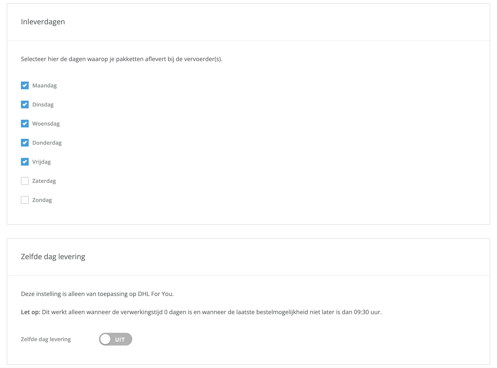

- **Inleverdagen** (Drop-off days). Tick the days on which you hand parcels to the carrier. The delivery days your customers see are calculated from these days. With no day ticked, the checkout only offers standard delivery without a date.
- **Zelfde dag levering** (Same-day delivery). Only for DHL For You, and only shown when DHL For You is ticked. It only works with a processing time of 0 days and a cut-off time no later than 09:30.

### Morning and evening delivery
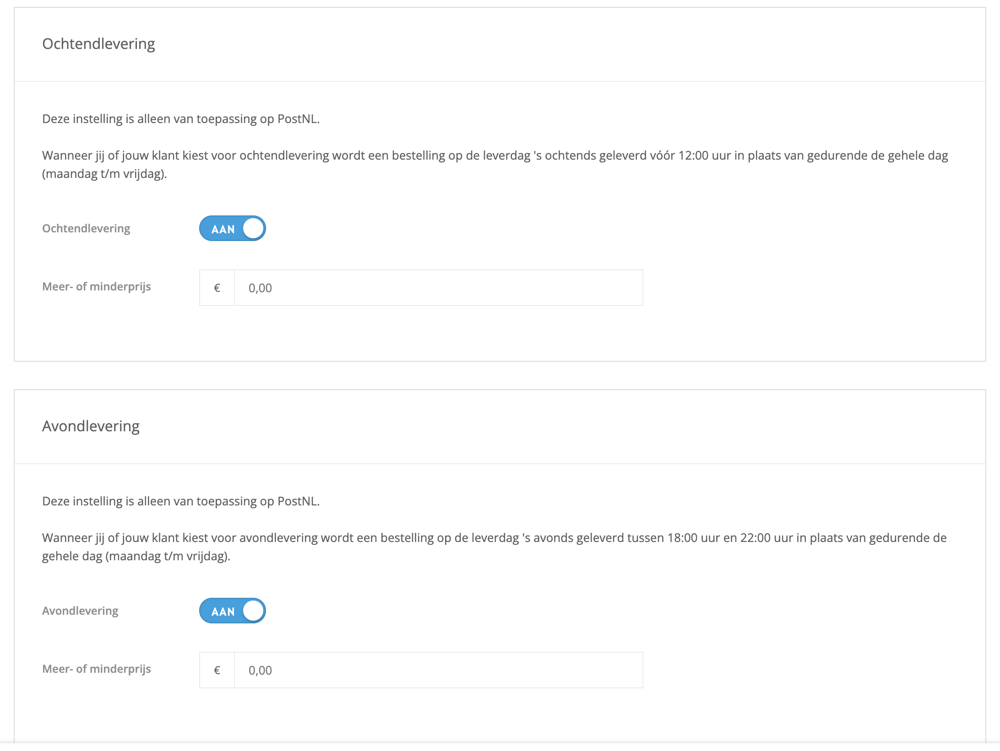

| Setting | What your customer gets |
| --- | --- |
| **Ochtendlevering** (Morning delivery) | Delivery before 12:00 instead of during the whole day, Monday to Friday. PostNL only. |
| **Avondlevering** (Evening delivery) | Delivery between 18:00 and 22:00, Monday to Friday. PostNL only. |

Once you switch an option on, a **Meer- of minderprijs** (Surcharge or discount) field appears. The amount is added to, or with a minus sign taken off, the shipping cost the customer pays for that option. Leave it at 0,00 to offer the option at no extra charge.

### Monday delivery and home address only
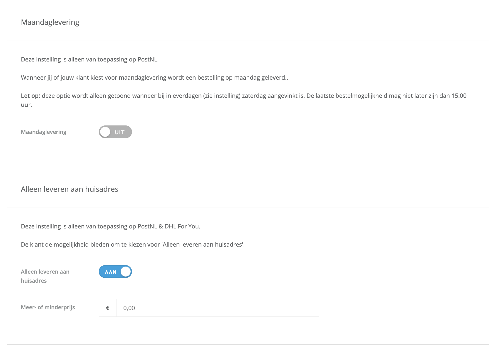

- **Maandaglevering** (Monday delivery). Delivery on Monday, PostNL only. It is only shown when Saturday is ticked under *Inleverdagen* and the cut-off time is no later than 15:00.
- **Alleen leveren aan huisadres** (Deliver to home address only). Lets your customer choose home address only. PostNL and DHL For You only.

### Signature and pickup points
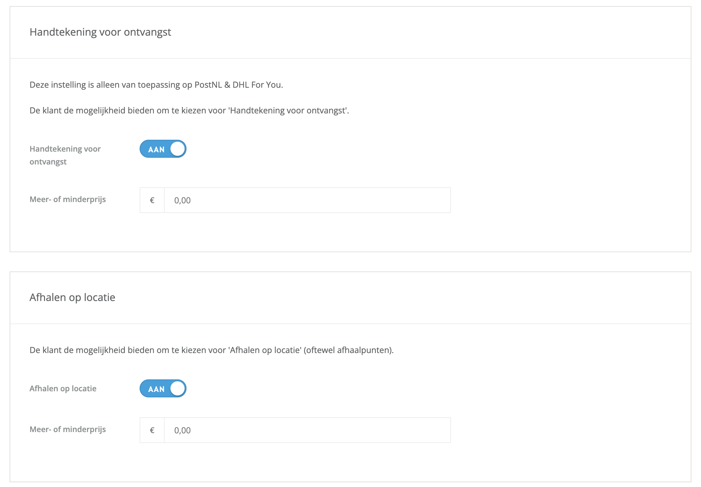

- **Handtekening voor ontvangst** (Signature on delivery). Lets your customer ask for a signature on delivery. PostNL and DHL For You only.
- **Afhalen op locatie** (Pickup at a location). Shows the pickup points of your ticked carriers, so your customer can collect the parcel at a shop or parcel locker nearby.

Each of these options has its own **Meer- of minderprijs** field once switched on.

::: tip Not the same as the defaults in §4
The options in §4 are what *you* add to every shipment. The options here are what your *customer* can pick at checkout. A customer's choice is carried over to the order.
:::

Click **Opslaan** (Save) when you're done.

## 6 · Product settings
These apps do not add product-level options. All shipping behaviour is controlled from the settings page and, per order, from the *Koppelingen* tab.

## 7 · The checkout experience
With **MyParcel Bezorgopties** installed, your customers choose **MyParcel** under *Afleveropties* (Delivery options) at checkout. As soon as they have filled in their postcode and house number, the delivery options appear.

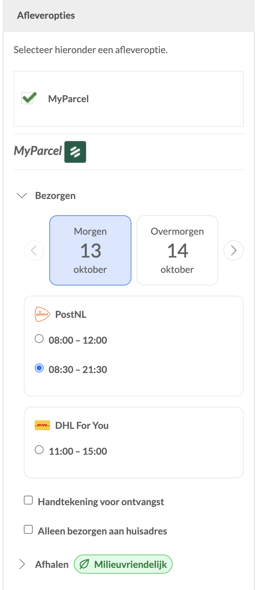

Under **Bezorgen** (Deliver) your customer picks:

- **A delivery day.** Use the arrows to see later days.
- **A carrier and time slot.** For each ticked carrier, the available time slots for that day. A morning slot appears when morning delivery is switched on.
- **Extra options.** The options you switched on in [§5](#5-delivery-options-at-checkout), such as *Handtekening voor ontvangst* and *Alleen bezorgen aan huisadres*.

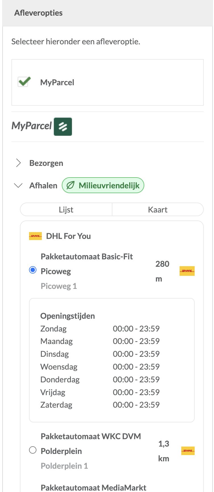

Under **Afhalen** (Pickup) your customer picks a pickup point from a **Lijst** (List) or on a **Kaart** (Map), sorted by distance and grouped per carrier, with the opening hours. Pickup carries a *Milieuvriendelijk* (Eco-friendly) label.

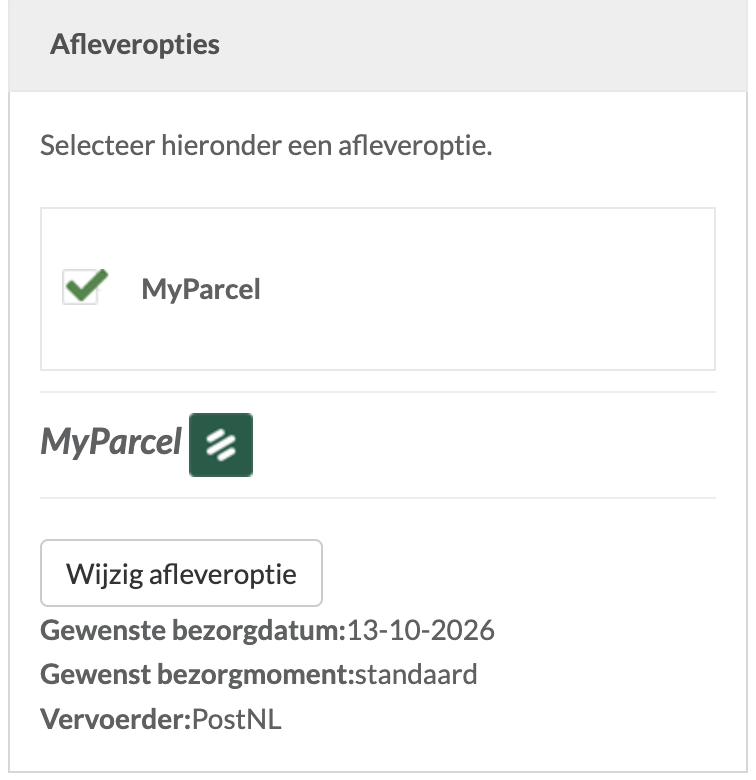

After choosing, the checkout shows a summary with the requested delivery date, time and carrier. **Wijzig afleveroptie** (Change delivery option) opens the choices again.

In your order management, the chosen delivery date appears as a note under *Verzending* (Shipping) on the order, and it is preselected as **Bezorgdatum** (Delivery date) when you register the order.

## 8 · Daily use
You can register one order at a time from the order itself, or many at once from the order list.

### One order
1. Go to **Mijn orders → Orderbeheer** (My orders → Order management) and open the order.
2. Open the **Koppelingen** (Integrations) tab. You'll find the section *Order exporteren naar MyParcel* (Export order to MyParcel).
3. Check the details. They are filled with your defaults from [§4](#4-default-shipment-settings) and with the customer's choice at checkout. You can change them for this order only.
4. Click **Meld de order aan bij MyParcel en download etiket** and confirm with **Order exporteren** (Export order).

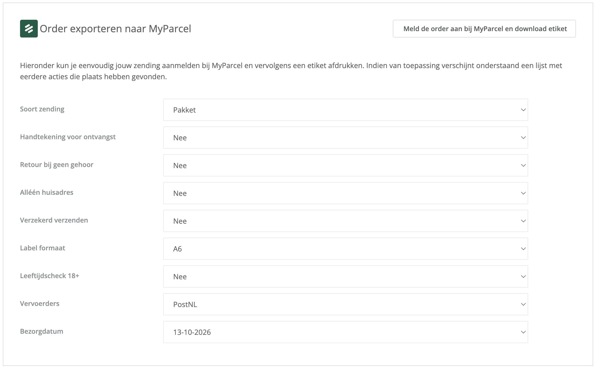

| Field | What it means for this order |
| --- | --- |
| **Soort zending** | Package type. Package options and insurance only show for packages. |
| **Handtekening voor ontvangst**, **Retour bij geen gehoor**, **Alléén huisadres** | *Ja* (Yes) or *Nee* (No) for each option. |
| **Verzekerd verzenden** | The insured amount for this parcel. |
| **Label formaat** | A6 or A4. With A4, **Label afdruk locatie** (Label print position) lets you choose the position on the sheet: *Links boven*, *Rechts boven*, *Links onder* or *Rechts onder* (top left, top right, bottom left, bottom right). |
| **Leeftijdscheck 18+** | Age check for this parcel. |
| **Vervoerders** | The carrier for this shipment. |
| **Bezorgdatum** | The delivery date, preselected from the customer's choice at checkout. |

The label downloads straight away as a PDF and a green *Succes* message confirms that the order was sent. The Track & Trace code is added to the order, under *Verzending* (Shipping) on the *Orderoverzicht* (Order overview) tab, with a link to follow the parcel.

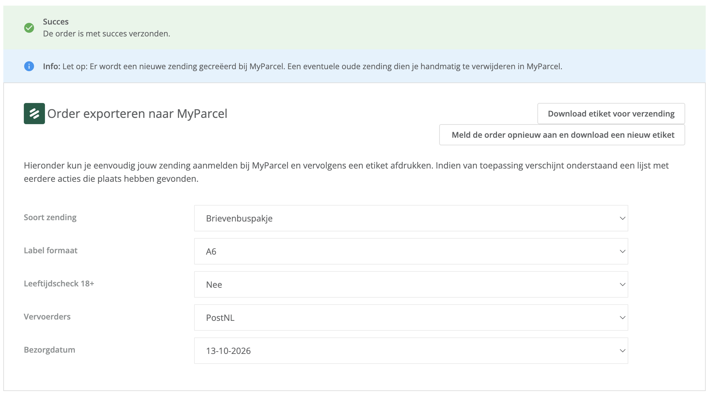

Once an order is registered, the section shows two buttons:

- **Download etiket voor verzending** (Download label for shipment) downloads the same label again, for example when the printer jammed.
- **Meld de order opnieuw aan en download een nieuw etiket** (Register the order again and download a new label) creates a new shipment, for example after you changed the package type.

The *Historie* (History) table below the sections logs every action with the date and time, the action, the integration and the result.

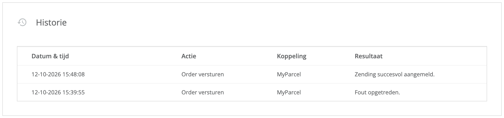

::: warning Registering an order again
Registering again creates a **second** shipment in MyParcel, the first one is not removed. CCV Shop warns you about this on screen. Delete the old shipment in your MyParcel backoffice to keep your overview clean. Only need the same label again? Use **Download etiket voor verzending** instead.
:::

### Many orders at once
1. In **Orderbeheer**, tick the orders you want to ship.
2. Open **Groepsactie selecteren** (Select group action) and choose **MyParcel etiketten** (MyParcel labels) under *Verzendservice*. With a MyParcel BE account, choose **MyParcel België etiketten**.

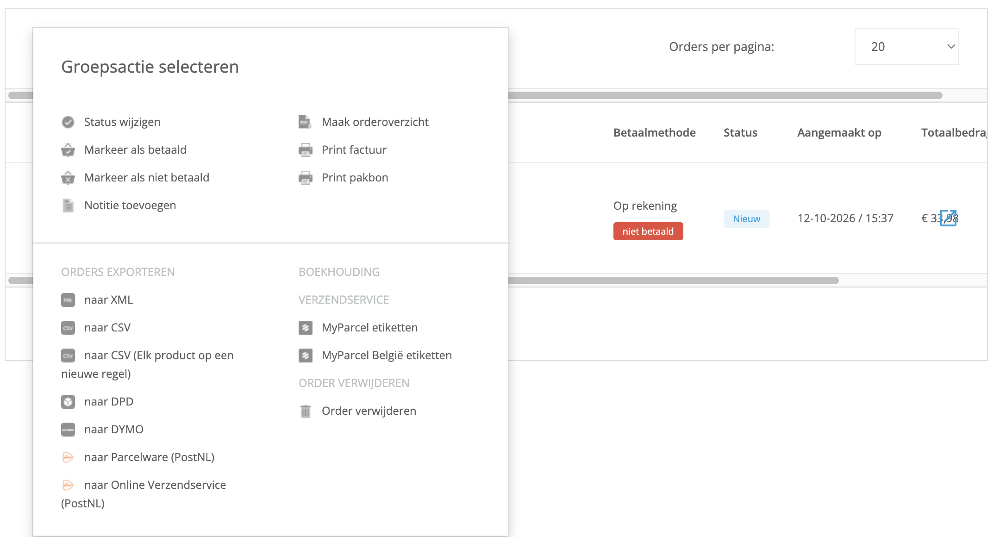

3. In the window that opens, choose the carrier under **Vervoerders** and, for A4 sheets, the **Label afdruk locatie**.
4. Click **Toepassen** (Apply) to register the selected orders and download their labels.

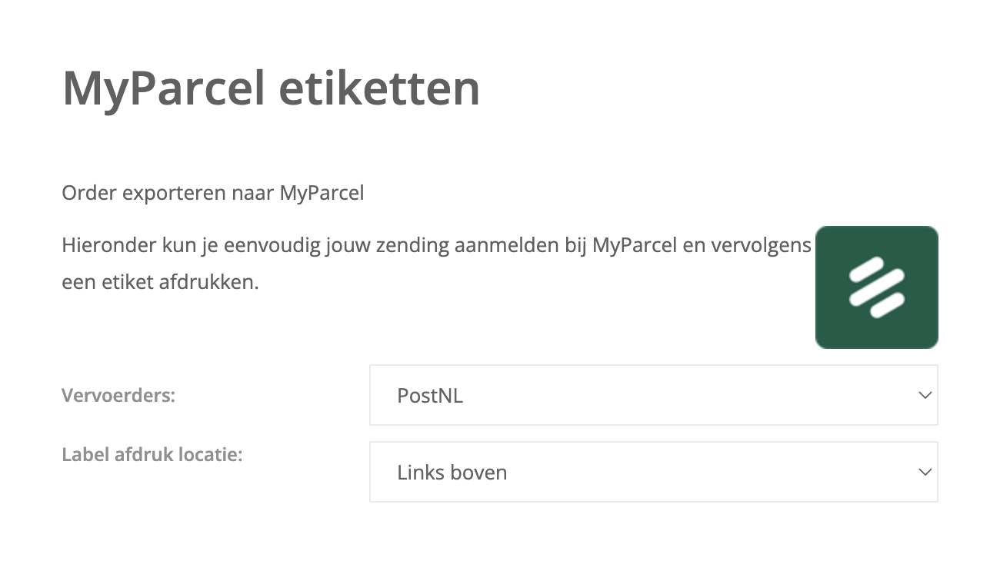

Every order in the batch uses your default settings from [§4](#4-default-shipment-settings). Does one order need something different? Register it on its own.

## 9 · Something's not working, diagnostics
Run through this table top to bottom, most issues are fixed within a few minutes.

| Symptom | What to check |
| --- | --- |
| **"Er is een fout opgetreden bij het verzenden van de order naar MyParcel"** and *Fout opgetreden* in the history | Is the **MyParcel API key** right, without spaces? Copy it again from the backoffice and save ([§3](#3-connecting-your-myparcel-account)). Is the chosen carrier active on your MyParcel account? |
| **No delivery options at checkout** | Is **MyParcel Bezorgopties** installed and is at least one carrier ticked under *Vervoerders* ([§5](#5-delivery-options-at-checkout))? Has the customer filled in a postcode and house number? Did the customer choose *MyParcel* under *Afleveropties*? |
| **Only standard delivery, no days or time slots** | Tick your drop-off days under *Inleverdagen* ([§5](#5-delivery-options-at-checkout)). |
| **Morning, evening or Monday delivery does not show** | These are PostNL only. Monday delivery also needs Saturday as a drop-off day and a cut-off time of 15:00 or earlier. |
| **Same-day delivery does not show** | DHL For You only, with a processing time of 0 days and a cut-off time of 09:30 or earlier. |
| **A carrier's options or pickup points are missing** | Is the carrier ticked and active on your MyParcel account? DHL Europlus has no pickup points. |
| **Two shipments in MyParcel for one order** | The order was registered twice. Delete the one you don't need in the MyParcel backoffice ([§8](#8-daily-use)). |
| **Wrong insured amount on the label** | Check **Verzekerd verzenden** per order before registering and check the label afterwards ([§4](#insurance-and-label-format)). |

## 10 · FAQ

### Who do I contact with a question?
For the apps and your CCV Shop back office: CCV Shop support. For your MyParcel account, contract, carriers and invoices: MyParcel ([Resources & support](#resources-support)).

### Where do I find my API key?
In [backoffice.myparcel.nl](https://backoffice.myparcel.nl) under *Shop settings → Integration*.

### Do I need MyParcel Bezorgopties?
Only if you want your customers to choose a delivery day, time slot or pickup point. To print labels, MyParcel Verzendservice is enough.

### Which carriers can I use?
For labels, the carriers listed under *Vervoerders* on the order: PostNL, DHL For You, DPD, UPS, DHL Parcel Connect and DHL Europlus. Only carriers that are active on your MyParcel account will accept shipments.

### Can I use an age check with evening or morning delivery?
No. An age check always comes with signature on delivery and home address only, and cannot be combined with morning or evening delivery.

### I ship from Belgium, which app do I use?
**MyParcel België Verzendservice**, together with a MyParcel BE account. MyParcel Bezorgopties works with both the Dutch and the Belgian app.

### Can I set shipping options per product?
No. Set your defaults on the settings page and adjust a single order on its *Koppelingen* tab.

### When am I billed?
MyParcel bills a shipment once it is actually handed over to the carrier.

## Resources & support
- [backoffice.myparcel.nl ↗](https://backoffice.myparcel.nl), account, API key, carriers and billing.
- [CCV Shop ↗](https://www.ccvshop.nl/), support for the apps and your CCV Shop back office: **+31 (0)88 990 7700** · [support@ccvshop.nl](mailto:support@ccvshop.nl).
- [Contact MyParcel support](../contact.md), **023 - 30 30 315** · [info@myparcel.nl](mailto:info@myparcel.nl).

This manual describes the MyParcel apps for CCV Shop as they work in October 2026. CCV Shop develops the apps and can change screens without notice.
