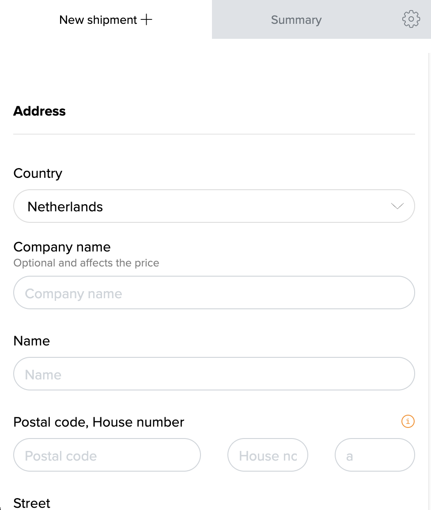
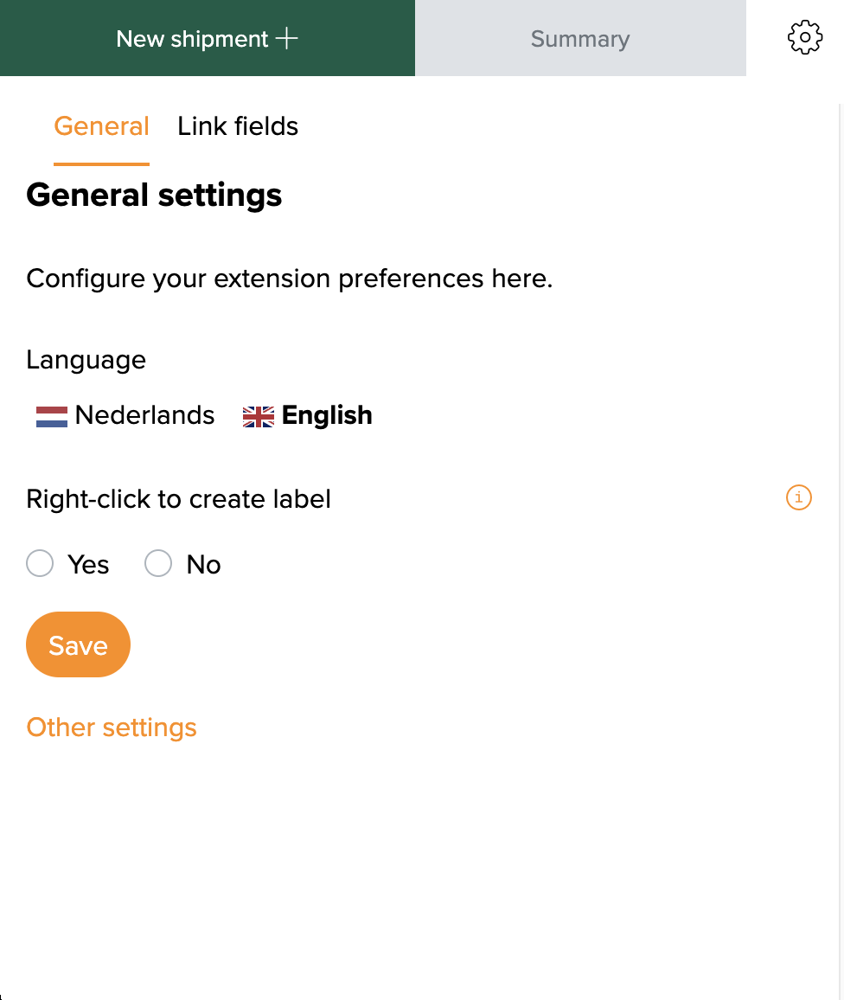
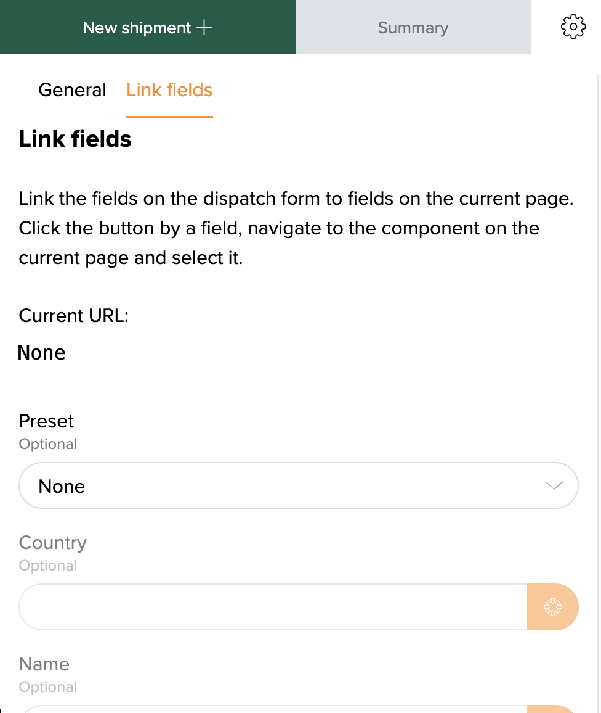

::: tip In short
The **MyParcel** extension for Google Chrome creates shipments from any web page. No plug-in is needed: open an order in your shop or marketplace, click the MyParcel icon, and the address is filled in for you in a MyParcel shipment form. You link the address fields of a website once, or you select an address on the page and create a label with a right-click. The shipment ends up in your MyParcel account like any other shipment.
:::

## Quickstart, your first label in 10 minutes
Enough to ship your first order today. For the details, see [Looking for…](#looking-for) below.

1. **Account.** Don't have a MyParcel account yet? Create one at [myparcel.nl/register](https://www.myparcel.nl/register).
2. **Install the extension.** Open [MyParcel in the Chrome Web Store](https://chromewebstore.google.com/detail/myparcel/ncomggonlkegodkmolbbepaebmoikbph) and click **Add to Chrome**.
3. **Pin it.** Click the puzzle piece at the top right of Chrome and pin **MyParcel**.
4. **Log in.** Click the MyParcel icon and log in with your MyParcel account.
5. **Create a label.** Select an address on any page, right-click and choose **Label aanmaken van selectie**. Check the shipment in the window that opens and save it.

::: tip You're done when you see this
- The MyParcel window opens next to your browser when you click the icon
- The address you selected appears in the shipment form
- The shipment shows up under **Summary** and in your MyParcel backoffice
:::

## Looking for…
| What do you want to do? | Go to |
| --- | --- |
| Understand what the extension does | [1 · How the extension works](#1-how-the-extension-works) |
| Install the extension and log in | [2 · Installing and logging in](#2-installing-and-logging-in) |
| Change the language or the right-click option | [3 · General settings](#3-general-settings) |
| Fill in the address automatically on your shop | [4 · Linking fields](#4-linking-fields) |
| Create a shipment from an order page | [5 · Creating a shipment](#5-creating-a-shipment) |
| Create a label from selected text | [6 · Creating a label with a right-click](#6-creating-a-label-with-a-right-click) |
| Something's not working | [7 · Something's not working, diagnostics](#7-somethings-not-working-diagnostics) |
| Answer to a frequently asked question | [8 · FAQ](#8-faq) |

## 1 · How the extension works
The extension is a small MyParcel window that opens next to your browser. It reads the address from the page you are on and fills it in on a MyParcel shipment form. You then check the shipment, choose the carrier and options, and save it. No shipment is created without you seeing it first.

There are two ways to get the address into the form:

| Way | When to use it |
| --- | --- |
| **Linking fields** | You ship from the same website every day, for example your own shop's order page. You link each address field once, and from then on the form fills itself. |
| **Right-click on a selection** | You ship now and then, or from a website with varying layouts. Select the address, right-click and the extension reads it. |

The shipments you create end up in your MyParcel account, where you can print them, also in one batch.

## 2 · Installing and logging in
1. Open [MyParcel in the Chrome Web Store](https://chromewebstore.google.com/detail/myparcel/ncomggonlkegodkmolbbepaebmoikbph). You also find it on the MyParcel website under the Google Chrome extension integration.
2. Click **Add to Chrome** and confirm.
3. Click the puzzle piece at the top right of Chrome and pin **MyParcel**, so the icon is always visible.
4. Click the MyParcel icon. A MyParcel window opens on the right of your screen.
5. Log in with your MyParcel account, the same way you log in to the MyParcel backoffice.

The window has three parts: **New shipment +** for the shipment form, **Summary** for the shipments you created, and the gear for the settings.

The extension is made for Google Chrome.

## 3 · General settings
Click the gear and open **General**.

| Setting | What it does | Recommended |
| --- | --- | --- |
| **Language** | The language of the extension window: **Nederlands** or **English**. | Your preference. |
| **Right-click to create label** | Adds **Label aanmaken van selectie** to Chrome's right-click menu, see [§6](#6-creating-a-label-with-a-right-click). | **Yes** |

Click **Save** after a change.

## 4 · Linking fields
Linking fields tells the extension where the address details are on a website. You do this once per website. After that, every order page on that website fills the form by itself.

1. Open an order in your shop, so the address is on screen.
2. Click the MyParcel icon, then the gear, and open **Link fields**. Under **Current URL** you see the website you are linking.
3. Check **Preset** first. For some well-known platforms MyParcel has already linked the fields for you. Choose your platform if it is listed, and you are done.
4. No preset? Click the orange button next to a field, for example **Name**.
5. The extension switches to your shop page and highlights the part of the page under your mouse. Click the element that holds the value. Press **Esc** to cancel.
6. The value appears in the field and is saved right away. Repeat this for every field you need.

All fields are optional. Link at least the name, the address and the country, and the email address and phone number if your shop shows them. The links are stored in your browser, per website, and travel with your Chrome profile if you use Chrome sync.

::: warning One layout per website
A link remembers the place of each field on the page. If your shop's order page changes, or different pages on the same website show the address differently, link the fields again or use the right-click instead.
:::

## 5 · Creating a shipment
1. Open the order in your shop.
2. Click the MyParcel icon. The form under **New shipment +** is filled in with the linked fields.
3. Check the address and complete the shipment: the carrier, the package type, the options and any extra details.
4. Save the shipment, or save it and print the label straight away.

Do you go to another tab or reload the page? The extension reads the page that is in front at that moment. The shipments you created are listed under **Summary** and in the shipment overview of your MyParcel backoffice.

You are only billed once a shipment is actually handed over to the carrier.

## 6 · Creating a label with a right-click
You don't need to link fields for this.

1. Select the address on the page with your mouse.
2. Right-click the selection and choose **Label aanmaken van selectie** (Create label from selection). This menu item is always in Dutch.
3. The MyParcel window opens with the selected address filled in on the form. MyParcel splits the text into name, street, house number, postal code and so on.
4. Check the address, complete the shipment and save it.

This works well for addresses abroad, or on websites where the layout differs from order to order. Don't see the menu item? Check that **Right-click to create label** is set to **Yes** ([§3](#3-general-settings)).

## 7 · Something's not working, diagnostics
Run through this table top to bottom, most issues are fixed within a few minutes.

| Symptom | What to check |
| --- | --- |
| **The MyParcel icon is missing** | Pin the extension via the puzzle piece at the top right of Chrome ([§2](#2-installing-and-logging-in)). |
| **The form stays empty** | Are the fields linked for this website ([§4](#4-linking-fields))? Reload the order page after installing the extension. |
| **Current URL shows the wrong website** | Click the order page first so it is in front, then open the extension again. |
| **The fields were filled before, now they aren't** | The layout of the page has changed. Link the fields again ([§4](#4-linking-fields)). |
| **The house number also ends up in the street** | Link **Street** and **House number** to separate elements on the page, or use the right-click ([§6](#6-creating-a-label-with-a-right-click)). |
| **No right-click option** | Set **Right-click to create label** to **Yes** and save ([§3](#3-general-settings)). |
| **Nothing is read from a page** | The extension does not read pages shown inside a frame. Open the order on its own page, or use the right-click. |

## 8 · FAQ

### Do I need a plug-in for my shop?
No. The extension works on any website, also when there is no MyParcel plug-in for your platform.

### Why does the extension ask for access to all websites?
It needs to read the address from the page you are on, and to highlight elements while you link fields. Only the values you link or select, and the address of the page, are sent to MyParcel.

### Where are my linked fields stored?
In your browser, per website. With Chrome sync on, they move with your Chrome profile to your other computers. They are not stored in your MyParcel account.

### Does it work in other browsers?
The extension is made for Google Chrome. Other browsers built on Chromium can install Chrome extensions too, but MyParcel builds and tests it for Chrome.

### Can I print many labels at once?
Yes. Create the shipments with the extension, then print them together from the shipment overview in your MyParcel backoffice.

## Resources & support
- [MyParcel in the Chrome Web Store ↗](https://chromewebstore.google.com/detail/myparcel/ncomggonlkegodkmolbbepaebmoikbph), install the extension.
- [backoffice.myparcel.nl ↗](https://backoffice.myparcel.nl), shipments, printing, account and billing.
- [Contact MyParcel support](../contact.md), **023 - 30 30 315** · [info@myparcel.nl](mailto:info@myparcel.nl).

This manual describes the MyParcel extension 2.8.3 for Google Chrome as it works in October 2026.
