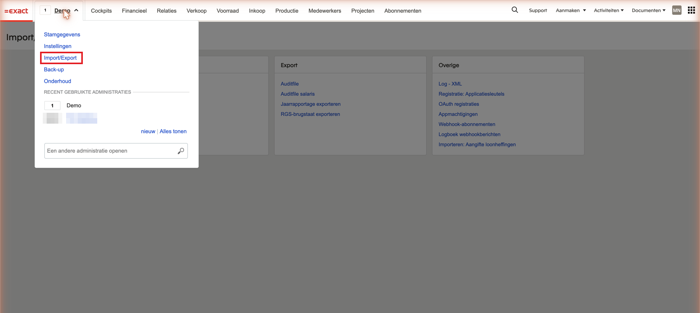
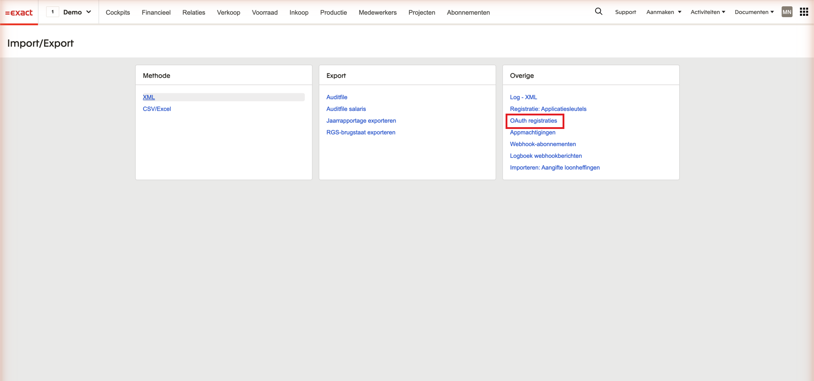
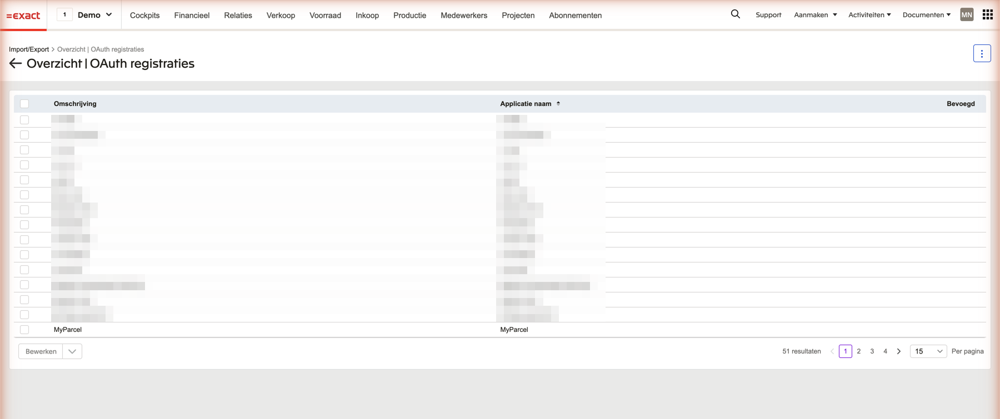
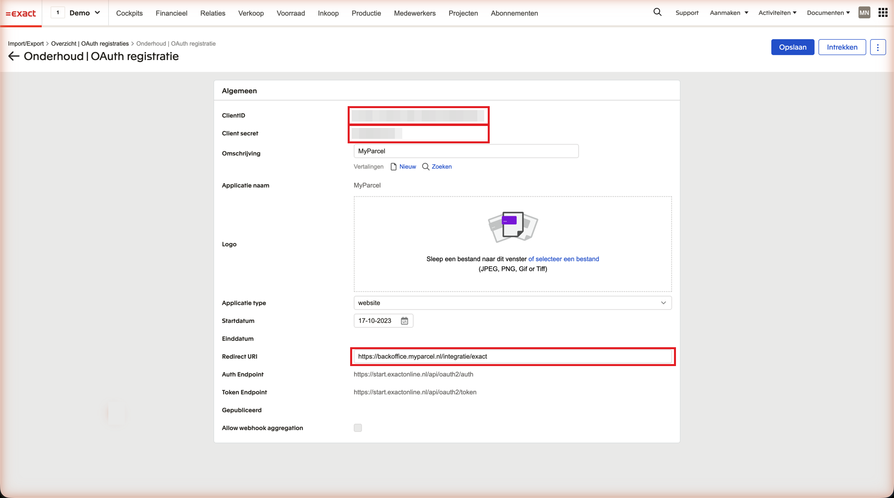

::: tip In short
Exact Online connects to MyParcel from the **Integration** page in your MyParcel backoffice, there is nothing to install. You register a MyParcel app once in Exact Online and copy its **Client ID** and **Client secret** into MyParcel. After that you import your open goods deliveries from Exact Online with one click. They arrive as **draft shipments**, and you create the labels in your MyParcel backoffice. MyParcel writes the barcode back to the goods delivery in Exact Online. You need the Exact Online module *Handel* for this connection.
:::

## Quickstart, your first goods deliveries in 10 minutes
Enough to link Exact Online to MyParcel today. For the details, see [Looking for…](#looking-for) below.

1. **Account.** Don't have a MyParcel account yet? Create one at [myparcel.nl/register](https://www.myparcel.nl/register).
2. **Register the app.** In Exact Online, click your administration name → **Import/Export** → **OAuth registraties** → **Nieuw**. Accept the terms and enter the redirect URI `https://backoffice.myparcel.nl/integratie/exact`.
3. **Copy the keys.** Save the registration and copy the **Client ID** and the **Client secret**.
4. **Paste the keys.** In [backoffice.myparcel.nl](https://backoffice.myparcel.nl) go to *Shop settings → Integration*, scroll to **External links**, open **Exact Online**, paste both keys and save.
5. **Import your goods deliveries.** In the *Shipments* overview, click **Import external orders**, select your goods deliveries and import them.

::: tip You're done when you see this
- The MyParcel app in the list under **OAuth registraties** in Exact Online
- Your new goods deliveries in the *Shipments* overview as draft shipments
:::

## Looking for…
| What do you want to do? | Go to |
| --- | --- |
| Understand how the connection works | [1 · How the connection works](#1-how-the-connection-works) |
| Register the MyParcel app in Exact Online | [2 · Registering the app in Exact Online](#2-registering-the-app-in-exact-online) |
| Connect Exact Online to your MyParcel account | [3 · Connecting MyParcel](#3-connecting-myparcel) |
| Import goods deliveries and print labels | [4 · Daily use](#4-daily-use) |
| Know how updates work | [5 · Updates](#5-updates) |
| Something's not working | [6 · Something's not working, diagnostics](#6-somethings-not-working-diagnostics) |
| Answer to a frequently asked question | [7 · FAQ](#7-faq) |

## 1 · How the connection works
Exact Online is accounting software, so there is no plugin to install. You register an app for MyParcel in your Exact Online administration. That gives you a Client ID and a Client secret. You enter both in your MyParcel backoffice, and MyParcel then reads your goods deliveries (*goederenleveringen*) from Exact Online.

You fetch your open goods deliveries yourself and they arrive in MyParcel as draft shipments. You create the labels in your MyParcel backoffice, and MyParcel writes the barcode back to the goods delivery in Exact Online.

::: warning You need the module Handel
The connection works with goods deliveries, and these are part of the Exact Online module *Handel*. Without this module there is nothing for MyParcel to import. Ask Exact Online about the module if you do not have it.
:::

The screens on the Exact Online side in this manual are in Dutch. Exact Online shows them in the language of your account.

## 2 · Registering the app in Exact Online
Since April 2026 you no longer find apps in the Exact App Store. You register the MyParcel app in your own Exact Online administration, under **OAuth registraties**.

::: warning You need the right Apps beheren
Only a user with the user right **Apps beheren** (manage apps) can register an app. Ask the administrator of your Exact Online account if you do not see the steps below.
:::

1. Log in to Exact Online. Click your administration name at the top of the page and choose **Import/Export**.

2. In the **Overige** column, click **OAuth registraties**.

3. You see the overview of your app registrations. Click **Nieuw** to register a new app for MyParcel.

4. Tick the checkbox to accept the terms and click **Accepteren**.
5. Fill in the registration:

   | Field | What to enter |
   | --- | --- |
   | **Applicatienaam** | A unique name for the MyParcel app, for example *MyParcel* followed by the name of your shop. |
   | **Redirect URI** | `https://backoffice.myparcel.nl/integratie/exact` |
   | **Omschrijving** | A short description, for example *MyParcel*. |

6. Save the registration. At the top of the page you now see a **ClientID** and a **Client secret**. Copy both, you need them in [§3](#3-connecting-myparcel).

::: warning Keep the Client secret to yourself
The Client ID and the Client secret together give access to your Exact Online administration. Only paste them in your MyParcel backoffice, never in an email or chat.
:::

## 3 · Connecting MyParcel
1. Log in to [backoffice.myparcel.nl](https://backoffice.myparcel.nl) and go to **Shop settings → Integration**.
2. Scroll down to **External links** and open **Exact Online** with the **+** button.
3. Paste the **Client ID** and the **Client secret** from [§2](#2-registering-the-app-in-exact-online). Watch out for spaces before or after the keys.
4. Save. If Exact Online asks you to log in and give MyParcel permission, do that with the account of the administration where you registered the app.

The connection is now ready to use.

## 4 · Daily use
1. In your MyParcel backoffice, open the **Shipments** overview and click **Import external orders**.
2. Your open goods deliveries from Exact Online are listed. Import them one by one with **Import**, or select several and import them in one go.
3. An imported goods delivery gets a green tick. The goods deliveries arrive as **draft shipments**. Click the pencil behind a shipment to change it, for example the package type or the delivery options.
4. Create the labels and hand the parcels to the carrier.

As soon as the shipment is registered with the carrier, MyParcel writes the barcode to the **Trackingnummer** field of the goods delivery in Exact Online.

::: warning Only new goods deliveries
MyParcel only imports goods deliveries that you create after you connect Exact Online. Goods deliveries that existed before the connection are not fetched.
:::

You are only billed once a shipment is actually handed over to the carrier.

## 5 · Updates
The connection runs in your MyParcel backoffice, so there is nothing to update. You always use the latest version.

## 6 · Something's not working, diagnostics
Run through this table top to bottom, most issues are fixed within a few minutes.

| Symptom | What to check |
| --- | --- |
| **You do not see OAuth registraties or the Nieuw button** | Your Exact Online user needs the right **Apps beheren**. Ask the administrator of your Exact Online account ([§2](#2-registering-the-app-in-exact-online)). |
| **Exact Online refuses the connection** | Is the **Redirect URI** exactly `https://backoffice.myparcel.nl/integratie/exact`? Are the **Client ID** and **Client secret** right, without spaces? Copy them again from the registration in Exact Online ([§2](#2-registering-the-app-in-exact-online)). |
| **No goods deliveries appear when importing** | Only goods deliveries created after you connected Exact Online are imported ([§4](#4-daily-use)). Do you have the module *Handel*? ([§1](#1-how-the-connection-works)) |
| **A goods delivery shows a red triangle when importing** | The delivery address is probably not complete or not right. Correct the address in Exact Online and import the goods delivery again. |
| **The barcode does not show up in Exact Online** | The barcode is sent once the shipment is registered with the carrier. Check the **Trackingnummer** field of the goods delivery. |

## 7 · FAQ

### Do I need to install anything?
No. Exact Online connects from your MyParcel backoffice, there is no plugin or app to install. You only register an app in Exact Online ([§2](#2-registering-the-app-in-exact-online)).

### Which Exact Online module do I need?
The module *Handel*. The connection imports goods deliveries, and these are part of that module.

### Can I still find MyParcel in the Exact App Store?
No. Since April 2026 you register the app yourself in Exact Online, under *Import/Export → OAuth registraties* ([§2](#2-registering-the-app-in-exact-online)).

### Are goods deliveries imported automatically?
No. You fetch your open goods deliveries yourself with **Import external orders** in the *Shipments* overview.

### Is the barcode sent back to Exact Online?
Yes. Once the shipment is registered with the carrier, MyParcel writes the barcode to the **Trackingnummer** field of the goods delivery.

## Resources & support
- [backoffice.myparcel.nl ↗](https://backoffice.myparcel.nl), integration, shipments, account and billing.
- [Exact Online ↗](https://www.exact.com/nl/).
- [Contact MyParcel support](../contact.md), **023 - 30 30 315** · [info@myparcel.nl](mailto:info@myparcel.nl).

This manual describes the Exact Online connection in the MyParcel backoffice as it works in November 2026.
